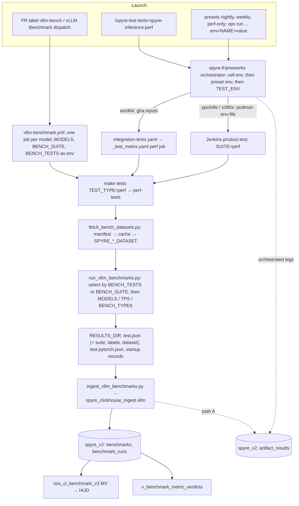

# Perf benchmark suites: launch to ClickHouse

How vLLM benchmark suites are selected, launched, run and recorded, end to end. It builds on
#1405 (the suite proposal) and #1511 (per-model configs selected by labels).

All data and examples come from the `spyre_v2` database of the dashboard ClickHouse, as of
2026-11-05. Metric values are elided. Only identities, keys and counts are shown. The ingest
also writes the legacy v1 tables, but nothing here uses or changes them.

## Summary

- **Suites stay inside `TEST_TYPE=perf`.** `BENCH_SUITE=minimal|base|reference` picks entries
  by their `labels` (#1511). A new `BENCH_TESTS` picks entries by name. No CI command line
  changes.
- **Every launch path forwards the same five variables** to `make perf-tests`: `BENCH_SUITE`,
  `BENCH_TESTS`, `MODELS`, `TPS` and `BENCH_TYPES`. spyre-frameworks already has the channel
  (a test cell's `env:`), but spyre-inference doesn't declare any of them yet.
- **One command, one environment.** Every path runs `make tests TEST_TYPE=perf`, and the run
  environment moves from the workflows into the `perf-tests` target. Today the paths set
  different env, and the drift already shows in the stored metrics.
- **ClickHouse keeps `test_type = perf`.** The suite is recorded as a run prop, never as part
  of the benchmark identity, so one config is one trend line whichever suite ran it.
- **Three problems in today's data must be fixed before #1511 starts ingesting:**
    - v2 keeps only one model per matrix run.
    - TP4 entries never land from CI.
    - #1511's `conc<N>` names aren't parsed.
- **#1511** needs six changes in the PR itself and three coordination steps around it (§5).
- **Startup time** is recorded as a benchmark of its own, one per server config, measured from
  a cold start. No new yamls.
- **Datasets** move to a versioned Artifactory layout, described by one manifest in this repo.
  The manifest also covers the vision dataset, which nothing can fetch today.

## 1. Today

### Launch paths

| Path | Trigger | Job | Cards | Command | Ingest | Writes `artifact_results` |
|---|---|---|---|---|---|---|
| A | `vLLM Benchmark` dispatch, or a PR labelled `vllm-bench` | `vllm-benchmark.yml`, one matrix job per model | 4 (`spyre_pf_x4`) | `make perf-tests MODELS=<model>` | inline `ingest_vllm_benchmarks.py`, dispatch only | the ingest (`source: gha`) |
| B | spyre-frameworks amd64 perf cell: nightly, weekly, perf-only, `/spyre-test tests=spyre-inference:perf` | `integration-tests.yaml` → `_test_matrix.yaml` job `perf` | 1 (`spyre_pf_x1`) | `make tests TEST_TYPE=perf` | composite action `ingest-vllm-benchmarks`, under the orchestrator's `run_id` | the orchestrator; the ingest when dispatched by hand |
| C | spyre-frameworks ppc64le/s390x perf cell, same presets | Jenkins `product-test`, `SUITE=perf` | 1 (`CARDS` defaults to 1) | `make tests TEST_TYPE=perf` | the cell's `ingest_cmd`, `ingest_vllm_benchmarks.py --run-id $RUN_ID` | the orchestrator |
| D | a manual run uploaded as a results bundle | `spyre_clickhouse_ingest` bundle upload | any | anything | same shaping | the upload (`source: bundle`) |

Paths A and B call different make targets, but `make tests TEST_TYPE=perf` only forwards to
`perf-tests`. The real difference is the environment each job sets around the call (§2.2).

Every path ends in `spyre_clickhouse_ingest.vllm` (torch-spyre
`extensions/clickhouse-ingest`). `extract_rows` parses the result files, and
`write_benchmarks` turns them into `benchmarks` and `benchmark_runs`.

### Where results land

All in `spyre_v2`:

| Table | Grain | Notes |
|---|---|---|
| `benchmarks` | one row per `benchmark_id` | identity: `uuid5(component, name, tags, discriminator props)`, written once per id |
| `benchmark_runs` | one row per (run, benchmark, backend) | `measurements` map plus run `props` |
| `artifacts`, `artifact_results` | one row per leg | what was tested, plus the verdict (`result_kind=performance`, `test_type=perf`) |
| `oss_ci_benchmark_v3` | one row per metric | MV over `benchmark_runs` ⋈ `benchmarks`, in the upstream HUD shape |
| `v_benchmark_metric_verdicts` | run × series × metric | series = (component, benchmark_id, backend, arch, source_job); baseline = previous 20 runs; direction and floor from `benchmark_metric_policy` |

spyre-inference data in `spyre_v2` covers 2026-09-22 to 2026-11-04: 1077 `benchmark_runs`
rows from 426 runs. `benchmarks` holds 168 spyre-inference names.

| arch | latency (rows / runs) | throughput (rows / runs) | serve (rows / runs / names) |
|---|---|---|---|
| x86_64 | 137 / 115 | 137 / 115 | 102 / 25 / 11 |
| ppc64le | 25 / 13 | 23 / 12 | 310 / 24 / 141 |
| s390x | 12 / 6 | 12 / 6 | 49 / 6 / 9 |

The remaining 270 rows (s390x, `run_mode=serving`) come from another writer
(`source: v1-eval-bridge`), not from the runner.

### One real leg, row by row

The leg is `integration-tests (perf) #3562`: GHA run 40833132965, 2026-10-29, x86_64, `main`
@ `2e18b37`.

```text
benchmarks
  benchmark_id  7f986995-5782-5e4b-ab61-a739a0430b48
  name          serve_granite41-8b_tp1_cics
  props         {record_type: model, run_mode: serve, tensor_parallel: 1, model: ibm-granite/granite-4.1-8b}

benchmark_runs
  run_id        508ba769-3ff0-5fc3-ab61-8b08f2d45d17
  backend       spyre
  iterations    100
  measurements  {mean_ttft_ms: [..], p99_ttft_ms: [..], mean_tpot_ms: [..], mean_itl_ms: [..],
                 output_throughput: [..], request_throughput: [..], mean_e2el_ms: [..], ...}   18 keys
  props         {report_kind: vllm, repo: spyre-inference, head_branch: main, head_sha: 2e18b37f...,
                 workflow_id: 40833132965, run_attempt: 1, job_id: 0, arch: x86_64,
                 hardware_type: IBM_Spyre, unit.mean_ttft_ms: ms, unit.output_throughput: tok/s, ...}

artifact_results
  artifact_id   d16c8220-1d64-5eda-b043-15c411603966
  run_id        508ba769-3ff0-5fc3-ab61-8b08f2d45d17
  result_kind   performance   test_type perf   state failed   arch x86_64
  props         {run_url: https://github.com/torch-spyre/spyre-inference/actions/runs/40833132965, source: gha}

oss_ci_benchmark_v3   (one row per metric)
  benchmark     (spyre_e2e_benchmark, serve, '', {benchmark_name: serve_granite41-8b_tp1_cics, device: spyre,
                 arch: x86_64, args: {"tensor_parallel_size":"1","input_len":"","output_len":""}})
  model         (ibm-granite/granite-4.1-8b, llm, spyre, [huggingface], {})
  metric        (mean_ttft_ms, [..], 0, {})
```

None of these rows records which configs were selected. With a single selection today, that
didn't matter.

### What the data shows

1. **v2 keeps one model per matrix run.**
    - `write_benchmarks` skips a leg when any row already exists for
      `(run_id, component, report_kind='vllm')`.
    - Every per-model job of path A derives the same `run_id` from `github.run_id`, the arch and
      `perf`. So the first job to ingest wins, and the others log "already present".
    - Example: `vLLM Benchmark` run 38582215656 ran 12 per-model jobs (see its GitHub run
      page). v2 holds one test from it: `serve_bge-reranker-v2-m3_tp1_in64`.
    - 71 x86_64 GHA legs, from 2026-09-28 to 2026-10-14, each hold one or two models and 1–2
      tests in v2. A path-A run without a `models` filter benchmarks every model in the CI set.
    - The HUD projection is fed from `benchmark_runs`, so it has the same gap.
2. **TP4 never lands from CI.**
    - Paths B and C lock one card, but every CI config set has TP4 entries.
    - No scheduled (`main`) leg on any arch has a TP4 row in v2. The only TP4 rows in v2 come
      from bundle uploads (ppc64le, 8 runs).
    - Those entries fail on every run, so the legs go red. Of 36 scheduled ppc64le/s390x legs,
      1 passed; the rest failed (14), errored (3) or never closed (18 still `running`).
    - On x86_64, every leg that ran the whole set `failed`: 10 legs with 11–13 tests each. The
      leg above is one of them (12 TP1 tests, `state: failed`).
    - Path A has 4 cards, but because of problem 1 each of its runs keeps only one or two models
      in v2, and none of those is a TP4 entry.
3. **#1511's names don't parse.**
    - `parse_input_shapes` reads `tp<N>`, `in<N>`, `out<N>`, `c<N>`, `n<N>`, `len<N>` and
      `seqs<N>`. `serve_gemma4-26b-a4b_tp4_conc5_all` parses to `{tensor_parallel: 4}` only.
    - 134 of the 168 spyre-inference names in `benchmarks` use `c<N>`; none uses `conc<N>`.
4. **The paths record different metrics for the same benchmark.**
    - Latency rows from the Jenkins legs (ppc64le, s390x) carry the native `avg_latency` and
      its percentiles, but never `latency`, the metric that comes from `.pytorch.json`.
      x86_64 GHA legs carry both.
    - The cause is `SAVE_TO_PYTORCH_BENCHMARK_FORMAT=1`, which only the two GHA workflows set.
      Path C never does, so the HUD's `latency` series exists only for x86_64.
5. **One dataset can't be fetched:** see §6.

## 2. Proposed flow



### 2.1 Selection

| Variable | Selects | Status |
|---|---|---|
| `BENCH_SUITE` | entries whose `labels` contain it: `minimal`, `base` (default) or `reference` | #1511 |
| `BENCH_TESTS` | entries by `test_name`, ignoring labels; an unknown name fails the run | new |
| `MODELS`, `TPS`, `BENCH_TYPES` | narrow either selection | exists |
| `BENCH_CONFIGS_DIR` | a directory, or a single file, which runs unfiltered | #1511 |

`BENCH_TESTS` replaces the label filter. The matrix generator already shares `collect_configs`
with the runner (#1511), so it gets the same selection for free. A matrix only ever contains
models that have a selected entry.

### 2.2 One command, one environment

Today path A runs `make perf-tests MODELS=<model>`, while paths B and C run
`make tests TEST_TYPE=perf`. The second form only forwards to `perf-tests`. A dry run
(`make -n`) shows the runner gets the same arguments either way, whether the selection
variables arrive on the command line or from the environment.

What really differs is the environment around the command. A dash means the job doesn't set
the variable, so the value comes from the image or the host profile.

| Variable | A (`vllm-benchmark.yml`) | B (`_test_matrix.yaml`) | C (Jenkins `product-test`) |
|---|---|---|---|
| `SAVE_TO_PYTORCH_BENCHMARK_FORMAT=1` | job env | step env | — |
| `AIU_SETUP_MULTI_AIU=1`, `TOKENIZERS_PARALLELISM=false` | job env | — | — |
| `VLLM_PLUGINS`, `DEVICE_NAME`, `DEVICE_TYPE` | job env | — | `VLLM_PLUGINS` from the image |
| `FLEX_COMPUTE`, `FLEX_DEVICE` | job env | — | `podman run -e`, `FLEX_DEVICE` per node |
| `VLLM_CPU_KVCACHE_SPACE`, `DTLOG_LEVEL` | job env (`16`, `error`) | — | — |
| `HF_HOME`, `HF_HUB_OFFLINE` | default cache, online | PVC cache, offline | — |

Two consequences of that drift:

- **Missing metrics.** Without `SAVE_TO_PYTORCH_BENCHMARK_FORMAT`, path C's latency rows lack the
  `latency` metric (§1, item 4).
- **Different settings for some configs.** 22 of #1511's 26 config files set
  `VLLM_CPU_KVCACHE_SPACE` and `DTLOG_LEVEL` in their own `environment_variables`, which
  override path A's job values. The other 4 (all-MiniLM-L6-v2, bert-base-NER, roberta-large-mnli
  and roberta-large-ner-english, all `reference` only) don't, so they run with `16` on path A
  and the platform default elsewhere.

Proposal:

- **One command.** Every path runs `make tests TEST_TYPE=perf`, the entry point every other
  tier uses, as do torch-spyre and hf-adapters. Path A drops `make perf-tests MODELS=...` and
  passes `MODELS` per matrix job, along with `BENCH_SUITE` and `BENCH_TESTS`. `perf-tests`
  remains the target `tests` calls, and is still there for local runs.
- **Selection arrives as environment on every path:** GHA step `env:` and the Jenkins
  env-file. The Makefile's `?=` reads it, so no caller builds its own make command line.
- **The run environment lives in `perf-tests`, not in the workflows.** The target exports
  these with `?=`, so a caller can still override them:
    - `SAVE_TO_PYTORCH_BENCHMARK_FORMAT=1`
    - `TOKENIZERS_PARALLELISM=false`
    - `AIU_SETUP_MULTI_AIU=1`
    - `VLLM_PLUGINS=spyre_inference`
    - `DEVICE_NAME=spyre`
    - `DEVICE_TYPE=IBM_Spyre`
- **Per-entry knobs stay in the configs.** `VLLM_CPU_KVCACHE_SPACE` and `DTLOG_LEVEL` move into
  the 4 encoder configs that lack them, and path A's job-level copies go.
- **The host keeps only hardware and infrastructure settings:**
    - `FLEX_COMPUTE` and `FLEX_DEVICE` (the Jenkins cell computes `FLEX_DEVICE` per node, since
      s390x exposes VF)
    - cache directories, `HF_*`, the secrets, and `SKIP_UV_FOR_BENCHMARKING`
- **One ingest entry.** Path A replaces its inline ingest step with the `ingest-vllm-benchmarks`
  composite action that path B uses, passing the prod or dev connection as inputs. Path C
  can't call a GHA action, so its `ingest_cmd` keeps calling the same
  `ingest_vllm_benchmarks.py`.

### 2.3 Who sets the variables

| Trigger | Suite | Mechanism |
|---|---|---|
| PR labelled `vllm-bench` | `minimal` | `vllm-benchmark.yml`: new `suite` and `tests` inputs, `minimal` on `pull_request` |
| `vLLM Benchmark` dispatch | input, default `base` | the same inputs |
| `/spyre-test tests=spyre-inference:perf` | `minimal` | the perf cell's declared env default |
| nightly, weekly | decision 1 | `env` on the preset's `test_map` entry |
| ops `run target=artifact:<id> preset=perf-only env=BENCH_SUITE=reference` | any | `TEST_ENV`, already allowed on `artifact:`, `tag:` and `<repo>@<ref>` targets |
| PR picks configs: `/spyre-test tests=spyre-inference:perf env=BENCH_TESTS=a,b` | — | needs spyre-frameworks to accept `env=` for declared perf names on PR runs; it is rejected today |

The spyre-frameworks side is one cell. It mirrors hf-adapters' `PERF_SCHEDULE`:

```yaml
# spyre-frameworks: pipelines/components/spyre-inference/config.yaml, the perf cell
- mode: perf
  default:
    workflow: jenkins_job
    env: {BENCH_SUITE: minimal, BENCH_TESTS: "", MODELS: "", TPS: "", BENCH_TYPES: ""}
    config:
      jenkins_job:
        params: {PRODUCT: spyre-inference, SUITE: perf, CARDS: "4"}   # see 2.4
  arch_overrides:
    amd64:
      config:
        gha:
          inputs:
            # ... existing inputs ...
            BENCH_SUITE: bench_suite
            BENCH_TESTS: bench_tests
            MODELS: models
            TPS: tps
            BENCH_TYPES: bench_types
```

- **Jenkins:** the values reach the container as env, and the Makefile's `?=` picks them up.
  The cell's `run:` lines don't change.
- **amd64:** the inputs are threaded through `integration-tests.yaml` and `_test_matrix.yaml`
  into the env of the `Run vLLM benchmarks` step. `workflow_dispatch` allows 25 inputs, and
  `integration-tests.yaml` has 12.
- **Test update:** `test_perf_cells_scope_perf_schedule_to_hf_adapters` expects
  spyre-inference's resolved perf env to be `{}`. A non-empty `BENCH_SUITE` default means
  updating that test.

### 2.4 Cards

TP4 entries need a 4-card leg. In #1511, 16 of the 28 `base` entries and 2 of the 5 `minimal`
entries are TP4.

| Option | Change | Cost |
|---|---|---|
| a. 4 cards per perf leg (recommended) | Jenkins perf cells set `CARDS: "4"`; the `_test_matrix.yaml` perf job runs on `spyre_pf_x4` | TP1 entries hold 4 cards too |
| b. Split legs | `{cards: 1, TPS=1}` and `{cards: 4, TPS=4}`, as trunk does on s390x | two ingests per `run_id`, safe once §3.3 lands |
| c. TP1 only on these legs | `TPS=1` on paths B and C | no TP4 coverage from scheduled runs |

### 2.5 Run

The runner works as in #1511, with two additions:

- **Annotated results.** Each native result JSON gets `suite`, the entry's `labels`, and
  `dataset` (logical name plus sha12). The runner already rewrites serve results to add
  `server_startup_sec`. Because the results describe themselves, no new flag is needed at the
  two ingest entries (the composite action, and the Jenkins `ingest_cmd`).
- **Startup records.** One per server config (§4).

## 3. Recording suites in ClickHouse

### 3.1 `test_type` stays `perf`

- `artifact_results.test_type` has a CHECK constraint that only allows the tier list
  (`smoke ... perf, quality, ...`), so a value like `perf_minimal` is rejected at insert.
- GHA's `run_id` is `uuid5(source|external_run_id|arch|test_type)`, and the orchestrator mints
  one `run_id` per mode (`_legRunId`). A per-suite `test_type` would fork run identity and break
  the joins.
- spyre-frameworks deliberately keeps `perf` off the smoke → trunk ladder.

### 3.2 The suite is a run prop, not identity

| Where | Key | Value |
|---|---|---|
| `benchmark_runs.props` | `suite` | `minimal`, `base`, `reference`, `tests` (for `BENCH_TESTS`) or `file` (for a single file) |
| `benchmark_runs.props` | `dataset`, `dataset_sha12` | the trace actually replayed; today this is only a name token |
| `artifact_results.props` | `suite` | path A, where the ingest owns the row; on orchestrated legs, the orchestrator's row could carry the cell env |

Both the GHA and Jenkins ingests write `benchmark_runs.props` (through `run_props` in
`bench_entries`). The suite stays out of `benchmarks.props`, `tags` and `name`, for two
reasons:

- They are hashed into `benchmark_id`.
- A `benchmarks` row is written once per id, so a later label change could never update it.

An entry's labels change over time, but what it measures doesn't.

Reading these rows:

- `props['suite']` says which selection produced a run. It does not say which suites an entry
  belongs to.
- A "minimal" trend chart should filter by the names in the minimal suite, because `base` and
  `reference` runs measure those entries too.
- Verdict series don't include `props`, so a suite never splits a series.

Here is the same kind of row under #1511 plus this proposal, for a nightly ppc64le leg with
`BENCH_SUITE=base`:

```text
benchmarks
  name          serve_granite41-8b_tp4_c5_cics
  props         {record_type: model, run_mode: serve, tensor_parallel: 4, concurrency: 5,
                 model: ibm-granite/granite-4.1-8b}

benchmark_runs
  run_id        <the orchestrator's RUN_ID for this build's perf mode>
  props         {...existing keys..., suite: base, dataset: cics, dataset_sha12: e0efa895b4a2}

artifact_results
  test_type perf   result_kind performance   props {..., suite: base}
```

### 3.3 Fixes to land before #1511's first ingest

1. **Name grammar.**
    - Use `c<N>` in #1511, as in `serve_<model>_tp<N>_c<C>_<dataset>`. The parser already reads
      it, and 134 existing benchmarks use it.
    - Teaching the parser `conc<N>` works too, but only if it lands first. Otherwise every new
      name gets a second `benchmark_id`.
2. **Dedup scope.** Make the dedup per leg instead of per run:
    - `write_benchmarks` passes a per-leg `source_file` to both `already_ingested` and
      `insert_benchmarks`, which already support it.
    - Path A passes `vllm-<model id with / replaced>`; single-leg paths pass nothing.
    - The value must be slash-free. `source_job` is the part of `source_file` before the first
      `/`, and it partitions verdict series. The HUD MV excludes only `optbench-*`.

## 4. Startup time

### 4.1 What startup time is

Before `vllm serve` can answer its first request, it goes through the steps below. The serve
benchmark only starts sending requests once they are all done, so none of the serve metrics
(TTFT, ITL, throughput) include them.

| Step | What happens | Where it shows in the server log |
|---|---|---|
| 1 | Python starts and imports vLLM and the spyre_inference plugin | not logged |
| 2 | The weights are loaded from the HF cache | `Loading weights took <s> seconds` (vLLM, once per worker) |
| 3 | Engine init: profile memory, create the KV cache, then compile and warm up | `init engine (profile, create kv cache, warmup model) took <s> s (compilation: <s> s)` (vLLM) |
| 3a | Part of 3: each transformer block is compiled for every token bucket | `Warmup complete in <s>s for <N> buckets.` (spyre_inference) |
| 3b | Part of 3: the attention kernels are recorded for every KV-length × query-length bucket, plus any vision graphs | no line of its own; it is inside `compilation` |
| 4 | The API server opens its port and `/health` answers | not logged |

`compilation` in step 3 is the whole Spyre warmup (3a plus 3b). `SpyreWorker.compile_or_warm_up_model`
times it and hands it to vLLM.

For a large model, most of the time goes into step 3. Its size grows with the context: the KV
buckets go up to `max-model-len`, so a 32k server has more attention kernels to record than an
8k one.

**Cold and warm starts.**

- Compiled kernels are saved in a local compile cache. `TORCHINDUCTOR_CACHE_DIR` holds both the
  Inductor and the Spyre kernels; it is the directory `nfs_compile_cache.py` ships between
  pytest jobs.
- A second start of the same server config finds its kernels there and skips most of step 3,
  much as a second build with ccache skips most compiles. That is a **warm** start; the first
  one is **cold**.
- Step 2 can also get faster the second time, because the OS keeps recently read weight files
  in memory.

Why it matters:

- Users pay startup on every restart and every new replica, and CI pays it on every serve entry.
- A change that makes step 3 slower moves none of the serve metrics, so today it would go
  unnoticed.

### 4.2 What exists today

1. **The runner measures it.** Since #984, `run_serve_benchmark` in `run_vllm_benchmarks.py`
   does this for every serve entry:
    - starts a clock just before launching `vllm serve`
    - polls `http://127.0.0.1:8000/health` once a second, giving up after
      `server_health_timeout` (180 s by default; gemma-4-26B-A4B's configs set 7200 s)
    - when `/health` first answers, stores the elapsed time as `server_startup_sec`, rounded to
      0.1 s
2. **It writes it into the result file.** After `vllm bench serve` finishes, the runner adds one
   key to `<test_name>.json`:

    ```text
    {
      "request_throughput": <req/s>,
      "mean_ttft_ms": <ms>,
      ...                               # the rest of vllm bench serve's output
      "server_startup_sec": <seconds>   # added by the runner
    }
    ```

3. **The ingest drops it.** `extract_vllm_metrics` keeps only the keys listed in
   `_SERVE_METRICS`, and `server_startup_sec` isn't one. The runner's own comment says so.
4. **So ClickHouse has no startup data.**
    - In `spyre_v2`, none of the 46 distinct metric keys stored for spyre-inference is about
      startup, warmup, compile or load, and there is no startup benchmark.
    - Example: `serve_gemma4-26b-a4b_tp1_cics` has 9 runs across x86_64, ppc64le and s390x,
      each with the same 18 serve metrics (`mean_ttft_ms`, `p99_itl_ms`, `output_throughput`,
      and so on). Every one of those runs measured `server_startup_sec`, and none kept it.
5. **Nothing reads the phase lines.** The runner saves the full server log as
   `<test_name>_server.log` next to the results, but no tool parses it.

### 4.3 Why not just ingest `server_startup_sec`

Adding it to `_SERVE_METRICS` would be a two-line change. To see what it would record, take
#1511's gemma-4-26B-A4B file. A `base` run of that model starts the server four times, once per
entry, in file order:

| # | Entry (with §5's `c<N>` names) | Server config | Compile cache when it starts | So `server_startup_sec` is |
|---|---|---|---|---|
| 1 | `serve_gemma4-26b-a4b_tp4_c5_aiops` | TP4, 32k, 32 seqs | empty | a cold start |
| 2 | `serve_gemma4-26b-a4b_tp4_c5_cics` | same as #1 | filled by #1 | a warm start |
| 3 | `serve_gemma4-26b-a4b_tp4_c5_all` | same as #1 | filled by #1 | a warm start |
| 4 | `serve_gemma4-26b-a4b_tp1_c5_cics` | TP1, 8k, 8 seqs | nothing for this config | a cold start |

The file's fifth entry, `..._tp4_c4_vision`, is `reference` only. Three problems:

- **#1, #2 and #3 measure the same server three times**, under three names that differ only in
  the dataset the client sends afterwards. The dataset has nothing to do with startup.
- **One name gets different kinds of start.** `..._tp4_c5_cics` is warm in a `base` run, because
  it follows #1, but cold when picked alone with `BENCH_TESTS=serve_gemma4-26b-a4b_tp4_c5_cics`.
  Its trend line would jump between cold and warm values, and the verdict view would flag a
  regression or an improvement that never happened.
- **Nothing records which kind it was,** so a dashboard can't separate cold from warm later.

It is like timing a car once on a cold morning and twice right after parking it: the three
numbers can't be compared.

### 4.4 What is proposed

1. **One startup record per server config, not per entry.** A server config is the model, TP,
   max-model-len, max-num-seqs, the other server flags and the env. Each distinct config gets
   one record, taken from its first start in the job. For the gemma `base` run above, that
   gives two records:

    | Record | Taken from | Not recorded |
    |---|---|---|
    | `startup_gemma4-26b-a4b_tp4_len32768_seqs32` | start #1 | #2 and #3, warm repeats of #1 |
    | `startup_gemma4-26b-a4b_tp1_len8192_seqs8` | start #4 | — |

    - A `minimal` run of the same model only has `..._tp4_c5_aiops`, so it produces the first
      record and nothing else. The same record means the same thing whichever suite ran it.
    - The name uses tokens ClickHouse already parses, so the identity needs no ingest change.
      I checked it against `parse_input_shapes`: `startup_gemma4-26b-a4b_tp4_len32768_seqs32`
      gives `{tensor_parallel: 4, max_model_len: 32768, max_num_seqs: 32}`.
    - If two configs share those four values but differ in other flags, the runner appends a
      short hash of the rest to the name.
2. **Always a cold start.**
    - Each distinct server config gets its own empty `TORCHINDUCTOR_CACHE_DIR` in the job's
      temp directory, so its first start compiles from scratch, whatever ran on the pod before.
    - Later starts of that config (#2 and #3) reuse its directory, but they aren't recorded.
    - The record carries `compile_cache: cold`.
    - The weight files may still be in the OS file cache; the phase split below keeps that
      visible.
3. **Split startup into phases.** The runner reads the saved server log and stores each phase
   next to the total:

    | Measurement | Source |
    |---|---|
    | `startup_s` | the runner's clock: launch to the first `/health` answer |
    | `load_weights_s` | `Loading weights took <s> seconds`; with TP>1 every worker logs one, and the runner keeps the slowest |
    | `init_engine_s` | `init engine (...) took <s> s` |
    | `compile_s` | the `compilation: <s> s` part of the same line: the whole Spyre warmup |
    | `bucket_compile_s` | `Warmup complete in <s>s for <N> buckets.` |

    Reading the split:
    - If `startup_s` regresses along with `compile_s`, look at compile or warmup changes.
    - If it regresses along with `load_weights_s`, look at loading or storage.
    - Attention recording is `compile_s - bucket_compile_s`.
4. **A result file the ingest understands.** For the first record, the runner writes
   `startup_gemma4-26b-a4b_tp4_len32768_seqs32.json` into `RESULTS_DIR`:

    ```text
    {
      "model": "google/gemma-4-26B-A4B",
      "startup_s": <seconds>,
      "load_weights_s": <seconds>,
      "init_engine_s": <seconds>,
      "compile_s": <seconds>,
      "bucket_compile_s": <seconds>,
      "compile_cache": "cold",
      "suite": "base"
    }
    ```

    The ingest learns this as a fourth record shape, recognized by `startup_s`, next to
    latency, throughput and serve. Every key ending in `_s` gets the unit `s`.
5. **What lands in `spyre_v2`:**

    ```text
    benchmarks
      name          startup_gemma4-26b-a4b_tp4_len32768_seqs32
      props         {record_type: model, run_mode: startup, tensor_parallel: 4,
                     max_model_len: 32768, max_num_seqs: 32, model: google/gemma-4-26B-A4B}

    benchmark_runs
      measurements  {startup_s: [..], load_weights_s: [..], init_engine_s: [..],
                     compile_s: [..], bucket_compile_s: [..]}
      props         {...the usual run keys..., suite: base, compile_cache: cold, unit.startup_s: s, ...}
    ```

    - The HUD shows it as a benchmark in mode `startup`, because its view turns every
      measurement key into a metric.
    - The verdict view compares each run with the previous 20 runs of the same record, and
      already treats these metrics as lower-is-better.
    - A `benchmark_metric_policy` row makes `startup_s` advisory with a wider tolerance, because
      loading weights from shared storage is noisy.
6. **Nothing new to configure.**
    - There is no new yaml, suite or bench type: the records come from the serve entries that the
      selected suite already runs.
    - The per-entry `server_startup_sec` stays in the serve result files for local debugging, and
      the ingest keeps ignoring it.
    - Latency and throughput benchmarks start their engine inside `vllm bench`, so they aren't
      covered.

### 4.5 Follow-up: start each server once

- **The saving:** today the gemma `base` run starts the server four times, and starts #2 and #3
  only repeat #1. Starting one server per distinct config and running its entries back to back
  brings that down to two starts.
- **The cost:** entries #2 and #3 would run on a server that has already served #1's requests.
  The prefix cache can be reset between entries with `/reset_prefix_cache`, which needs
  `VLLM_SERVER_DEV_MODE=1`.

This is decision 5 in §8.

## 5. #1511 and the #1405 discussion

### What #1511 already matches

- `BENCH_SUITE` works inside `TEST_TYPE=perf`; no caller's command line changes, and `base` is
  the default.
- The matrix generator loads the runner and calls the same `collect_configs`, so the matrix and
  the run can't disagree.
- Missing or unknown labels and duplicate `test_name`s fail the run.
  `test_checked_in_test_names_and_labels_are_valid` does what torch-spyre's
  `check_oot_configs.py` does there.
- The trace fetch depends on `BENCH_TYPES`, not `BENCH_SUITE`, and the special case for the
  multimodal file is gone.
- **The rename is right.** The configs behind the serve entries changed, so new names give an
  honest new series:

| Before | After (with the `c<N>` grammar below) |
|---|---|
| `serve_gemma4-26b-a4b_tp4_cics`: 8k context, 4 seqs, concurrency 4, 50 prompts | `..._tp4_c5_cics`: 32k, 32 seqs, concurrency 5, 200 prompts, chunked prefill |
| `serve_granite41-8b-fp8_tp4_aiops`: 4k, 4 seqs, concurrency 4, 50 prompts | `..._tp4_c5_aiops`: 32k, 32 seqs, concurrency 5, 200 prompts, chunked prefill |

### What #1511 needs to address

#### Required in #1511

Each of these touches files #1511 already changes. Item 1 is cheap now, but expensive once the
new names have been ingested.

1. **Name serve entries `serve_<model>_tp<N>_c<C>_<dataset>`, not `conc<C>`.**
    - Rename `conc<N>` to `c<N>` in the `test_name`s of all 26 config files. For example,
      `serve_gemma4-26b-a4b_tp4_conc5_aiops` becomes `serve_gemma4-26b-a4b_tp4_c5_aiops`, and
      `serve_all-MiniLM-L6-v2_tp1_conc16` becomes `serve_all-MiniLM-L6-v2_tp1_c16`.
    - Switch the tail parser in `generate_bench_config_tables.py` from `conc<C>_<dataset>` to
      `c<C>_<dataset>`, regenerate the README tables, and update the one test that names a
      `conc` entry.
    - Why in #1511: no `conc` name has been ingested yet, and the first ingest fixes each new
      `benchmark_id`. Teaching the parser `conc` instead would need a torch-spyre change on
      `main` *and* a torch-spyre-dev image rebuild, because the Jenkins legs ingest with the copy
      of the library baked into the image.
2. **Let `vllm-benchmark.yml` choose the suite.** Today it never passes `--suite` and has no
   `suite` input, so dispatch and the PR label always run `base`.
    - Add a `suite` dispatch input (`minimal`, `base` or `reference`; default `base`) and pass it
      to `generate_vllm_benchmark_matrix.py --suite`.
    - Use `minimal` on `pull_request`, so the `vllm-bench` label runs the short set.
3. **Run path A through the shared entry point** (§2.2). #1511 already edits this step:

    ```yaml
    - name: Run vLLM benchmarks
      env:
        MODELS: ${{ matrix.models }}
        BENCH_SUITE: ${{ matrix.suite }}
        RESULTS_DIR: benchmark-results
        SKIP_UV_FOR_BENCHMARKING: ${{ inputs.skip_uv_for_benchmarking && '1' || '' }}
      run: |
        mkdir -p "${RESULTS_DIR}"
        make tests TEST_TYPE=perf
    ```

    `TEST_TYPE`, `RESULTS_DIR`, `MODELS` and `BENCH_SUITE` are all `?=` in the Makefile, so the
    step env reaches the runner unchanged.
4. **Give the 4 reference encoder configs their own env.** Add `VLLM_CPU_KVCACHE_SPACE: 64` and
   `DTLOG_LEVEL: error`, as the other encoder configs have, to all-MiniLM-L6-v2,
   bert-base-NER, roberta-large-mnli and roberta-large-ner-english. Path A's job-level values
   can then be removed without changing any entry (§2.2).
5. **Document reference's dataset requirement.**
    - Its 5 `_vision` entries need `SPYRE_VISION_DATASET`, which nothing fetches yet (§6), and a
      missing dataset aborts the run.
    - The matrix fallback can route a vision-only model (granite-vision-4.1-4b) into
      `reference`, so the README should say the variable must be set by hand until the dataset
      is mirrored.
6. **Announce the series cutover in the PR description.**
    - Every serve `test_name` changes, so the 16 serve series in v2 end at merge and new ones
      begin. The 4 latency and throughput names carry on.
    - The configs changed too (table above), so the break is real, not cosmetic.

#### Coordinate before #1511 drives scheduled and PR legs

7. **Cards.**
    - Once #1511 merges, paths B and C run `base` by default: 16 TP4 entries instead of today's
      7, all on one card.
    - Land the cards change in spyre-frameworks (§2.4) at the same time, or have those cells
      pass `TPS=1` until it does. That needs the cell `env:` from §2.3.
    - `minimal` has the same problem on those legs: 2 of its 5 entries are TP4.
8. **Time.** `base` is longer than today's set: 28 entries instead of 20, each heavier. Path B
   runs it as one sequential job, while the amd64 cell waits only 3 h. Raise that cell's
   `timeout_hours`, or run `minimal` nightly (decision 1).
9. **Ingest.**
    - #1511 doesn't make the v2 dedup problem worse, but doesn't fix it either. Until the
      per-leg `source_file` lands in clickhouse-ingest (§3.3), path A keeps landing one model
      per run in v2.
    - Once it lands, path A's ingest passes the leg key (in #1511, if it's ready by then).

#### Can follow #1511

None of these needs #1511 to wait:

- `BENCH_TESTS`, and the `tests` input in `vllm-benchmark.yml` (§2.1)
- writing `suite`, `labels` and `dataset` into the results (§2.5, §3.2)
- startup records (§4)
- exporting the run env from `perf-tests`, dropping the workflow copies, and moving path A to
  the composite ingest action (§2.2)
- the dataset manifest and the Artifactory layout (§6)

### Points from the #1405 discussion

- **PR perf defaults to `minimal`:** yes, set through §2.3.
- **Picking individual configs on a PR:** yes, with `BENCH_TESTS`.
    - The unknown-name check matters: `serve_gemma4-26b-a4b_tp4_conc16_all` doesn't exist in
      #1511, because commit 67db142 dropped the concurrency 4/8/16/32 sweep.
    - An `env=` value is limited to 256 characters, which fits about three or four names.
    - A TP4 pick also needs a 4-card leg.
- **`minimal` ⊂ `base`, but `base` ⊄ `reference`:** not a problem. Labels make nesting
  irrelevant. Only the matrix fallback walks the suites in order, and only to find the first one
  that has a requested model.
- **`base` differs from today's CI set and uses the `all` dataset:** agreed. The rename breaks
  the trend lines once anyway, so this is the time to do it.

## 6. Datasets

### Today

- **Fetch.** Serve configs reference `${SPYRE_*_DATASET}`. `make perf-tests` runs
  `fetch_bench_datasets.py`, which:
    - downloads from `${ARTIFACTORY_BASE_URL}/artifactory/${ARTIFACTORY_DATA_PATH}/<path>`
      into `SPYRE_BENCH_DATA_DIR` (the shared PVC on x86 runners;
      `~/.cache/spyre/artifacts` by default)
    - verifies each file's sha256 and exports the variables
    - keeps any variable that already points at an existing file
- **Layout.** One flat, version-stamped directory,
  `spyre-inference/vllm-bench-data/converted_traces/2025.11.03_e2ee1b0_reordered/`, holding
  13 JSONL files. Each file name repeats the version.
- **The list is written twice:** `ARTIFACTS` in `fetch_bench_datasets.py`, and
  `artifactory_datasets` in `.github/cache_config/hf_models_and_datasets.yaml` (used by
  `add_or_remove_artifacts_from_cache.yaml`). A comment asks to keep the two in step.
- **All or nothing.** All 13 files are fetched whenever `serve` is selected.
- **Vision is missing.** `SPYRE_VISION_DATASET` is in neither list and has no default. vLLM's
  `custom_image` reads a JSONL whose rows point at image files, so it is a multi-file dataset,
  which the current single-file entry can't describe.
- **A missing dataset for a selected entry aborts the whole run.**

### Proposed Artifactory layout

```text
${ARTIFACTORY_DATA_PATH}/spyre-inference/bench-datasets/
    traces/
        aiops/2025.11.03-e2ee1b0/aiops.jsonl
        cics/2025.11.03-e2ee1b0/cics.jsonl
        all_sequences/2025.11.03-e2ee1b0/all_sequences.jsonl
        all_sequences/2025.11.03-e2ee1b0/all_sequences_truncated_32k.jsonl
        db2/2025.11.03-e2ee1b0/db2.jsonl
        ...
    vision/
        <name>/<version>/<name>.tar.zst        # the JSONL plus its images, with relative paths
```

- **`<family>/<name>/<version>/`.** A new version is a new directory, never an overwrite, so an
  old run can always be reproduced.
- **The version appears once, in the directory.** File names stay stable across versions.
- **A multi-file dataset is one archive.** Its paths are relative to the archive root.
- **Moving files is cheap.** The content and its sha256 don't change, so a move is a copy. The
  local cache mirrors the Artifactory path, so each cache re-downloads the 13 files (474 MB)
  once.

### Code changes

1. **One manifest in the repo** (for example `vllm-benchmarks/datasets.yaml`), read by both
   `fetch_bench_datasets.py` and `manage_cache.py`. It replaces both lists:

    ```yaml
    root: spyre-inference/bench-datasets
    datasets:
      - env: SPYRE_AIOPS_DATASET
        family: traces
        name: aiops
        version: 2025.11.03-e2ee1b0
        file: aiops.jsonl
        sha256: 468cf059f2ec3b14108efc09baffabf5c5a440172a25660673d5a8fa029d0637
      - env: SPYRE_VISION_DATASET
        family: vision
        name: <name>
        version: <version>
        archive: <name>.tar.zst
        entry: <name>.jsonl
        sha256: <sha256 of the archive>
    ```

2. **Archive entries.** Download and verify the archive, extract it into
   `<cache>/<family>/<name>/<version>/`, and export the path of `entry` inside it. The vision
   dataset needs this.
3. **Fetch what is selected.**
    - The runner knows which `${VAR}`s its selected entries use, so hosts that fetch for
      themselves (Jenkins nodes) can fetch only those. With `minimal` as the default, most legs
      need one or two files.
    - The cache writer workflow keeps mirroring every manifest entry to the shared PVC, because
      fork PRs get no secrets and can't fetch anything for themselves.
4. **Results carry `dataset` and `dataset_sha12`** (§3.2). A trace refresh then shows up as a
   prop change instead of an unexplained jump.
5. **Unchanged:** the secrets (`ARTIFACTORY_BASE_URL`, `ARTIFACTORY_DATA_PATH`,
   `ARTIFACTORY_TOKEN`), the PVC cache, the `${SPYRE_*_DATASET}` names in configs, and the
   per-arch `ARTIFACTORY_DATA_PATH` param on the Jenkins cells.

## 7. Work items, in order

| # | Repo | Change | Needed before |
|---|---|---|---|
| 1 | torch-spyre `extensions/clickhouse-ingest` | per-leg `source_file` dedup; read `suite`, `labels` and `dataset` into run props; startup record shape, unit and policy row | #1511's first ingest |
| 2 | spyre-inference #1511 | `c<N>` names; `suite` input with `minimal` on PRs; path A on `make tests TEST_TYPE=perf`; env for the 4 encoder configs; README note on `SPYRE_VISION_DATASET`; cutover note (§5) | merge |
| 3 | spyre-inference | `BENCH_TESTS` and the `tests` input; write suite, labels and dataset into results; startup records; the five inputs in `integration-tests.yaml` and `_test_matrix.yaml`; path A on the composite ingest action, with a leg key; run env exported from `perf-tests` (§2.2) | after 2 |
| 4 | spyre-frameworks | perf cell `env:` and `gha.inputs`; cards (§2.4); preset env for nightly and weekly; `env=` for perf names on PR runs; update the env test | after 3 |
| 5 | spyre-inference, Artifactory | dataset manifest, the new layout, archive support, the vision dataset | reference runs in CI |

## 8. Decisions for the team

1. **Suite per schedule:** nightly `minimal` or `base`; weekly `base` or `reference`.
2. **Cards for perf legs:** 4 cards, split legs, or TP1 only (§2.4).
3. **Name grammar for #1511:** confirm `c<N>` (§5). Keeping `conc<N>` would need the parser
   change and a torch-spyre-dev image rebuild before the first ingest.
4. **Dataset layout,** and who owns the Artifactory move.
5. **Server reuse** for entries with identical server configs (§4.5).
