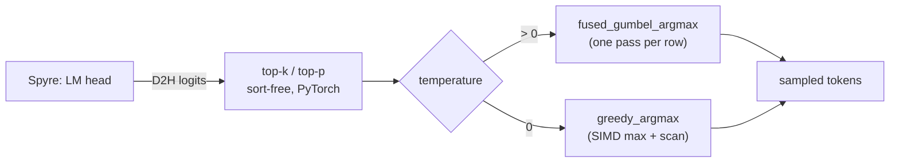
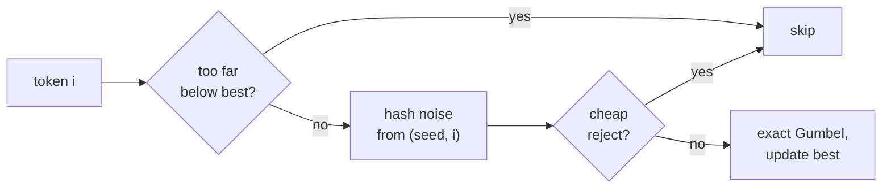
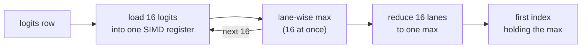

# ADR 0001: Sample on the host CPU with fused C++ kernels

| Field | Value |
|---|---|
| Status | Accepted, implemented in [#1111](https://github.com/torch-spyre/spyre-inference/pull/1111) |
| Date | 2026-11-10 |
| Deciders | Rehan Khan ([@R3hankhan123](https://github.com/R3hankhan123)), Rishika Kedia ([@rishikakedia](https://github.com/rishikakedia)), Dilip Gowda Bhagavan ([@dilipgb](https://github.com/dilipgb)), Thomas Ortner ([@bohnstingl](https://github.com/bohnstingl)), Thomas Parnell ([@tdoublep](https://github.com/tdoublep)), Joe Runde ([@joerunde](https://github.com/joerunde)) |
| Related | vLLM CPU backend `csrc/cpu/sampling_kernels.cpp`; [vllm#59786](https://github.com/vllm-project/vllm/issues/59786) (Gumbel table bias) |

## Context

Spyre cannot sample on the card. `SpyreLogitsProcessor` copies the logits to the host, so every
sampling step runs on the host CPU, serially between device forward passes. Its cost adds
directly to time per output token.

`TorchSpyrePlatform` is `PlatformEnum.OOT`, so `is_cpu()` is `False`, and vLLM's
`TopKTopPSampler` takes `forward_native`: eager PyTorch, without the fused kernels upstream
reserves for `forward_cpu`. For a batch of `B` rows and a vocabulary of `V` tokens, that path:

- **Random sampling:** fills a fresh `[B, V]` exponential noise tensor, then subtracts, takes
  the log and reduces it, each as a separate pass over memory. At `V = 262144` the fp32 noise
  alone is 1 MB per row, generated on every step.
- **Greedy sampling:** runs an eager `torch.argmax` over all `B × V` logits.
- **Top-k + top-p:** sorts the full vocabulary.

With large vocabularies (gemma-4: 262k tokens) and high concurrency, this was a large share
of each decode step.

Constraints on any solution:

- Sample exactly from `softmax(logits)`, including the tail of a large vocabulary.
- Keep seeded requests reproducible.
- Run on every host ISA spyre-inference ships on: x86_64, ppc64le and s390x.
- Add no user-facing flags.

## Decision

Sampling stays on the host and runs in two C++ kernels in `csrc/cpu/sampling_kernels.cpp`,
ported from vLLM's CPU backend and registered under `torch.ops._spyre_C`. Both take fp32, 2-D,
CPU logits.



### 1. Random sampling: fused Gumbel-max with hashed noise

If `g_i ~ Gumbel(0, 1)` independently, `argmax_i(x_i + g_i)` is distributed exactly as
`softmax(x)`, so no softmax is needed. `fused_gumbel_argmax` computes that argmax in one pass
per row and never stores noise:

```text
key  = splitmix64(seed)
bits = splitmix64(key + (i + 1) · 0x9E3779B97F4A7C15) >> 11     # 53 bits
u    = (bits + 0.5) · 2^-53                                     # in (0, 1)
g_i  = -log(-log u)
```

- **Seeds:** one 62-bit seed per row on each step. A seeded request draws its row seed from its
  own `torch.Generator`, so it stays reproducible.
- **Exact pruning:** with 53-bit `u`, `g ≤ 37.43 < 37.5`, so a token more than 37.5 below the
  running best is skipped before any noise is computed. That covers every `-inf` left by
  top-k/top-p, and most of a typical row.
- **Cheap rejection:** a surviving token wins only if `-log u < exp(dx - best_g)`. Since
  `-log u ≥ 1 - u`, the test `1 - u ≥ exp(dx - best_g)` rejects most candidates with one `exp`;
  only the rest pay for the two `log`s.
- **Comparison space:** the kernel compares `(x - best_x) + g > best_g`, so the noise isn't lost
  to rounding when added to a logit near the float max.
- **Parallelism:** the row loop is scalar, because pruning makes it branchy. Rows run in
  parallel with OpenMP; a batch of one skips the OpenMP region.

For each token in a row:



### 2. Greedy sampling: SIMD argmax

`greedy_argmax` loads 16 fp32 logits per step into a `vec_op::FP32Vec16` (AVX512 or AVX2, VSX,
VXE) and takes a lane-wise max. It reduces the 16 lanes to one value, then scans for the first
index that holds it, so ties break like `torch.argmax`. Rows run in parallel with OpenMP.



Vector max has no consistent NaN rule on any of the three ISAs, so the loop also keeps a running
vector sum. If the sum is NaN, the kernel returns the first NaN, matching `torch.argmax`.

### 3. Sort-free top-k + top-p

`apply_top_k_top_p_sort_free` runs top-p on a `topk` window of `2 × max_k` instead of a
full-vocabulary sort, widening the window to the exact tie count when ties run past it. Top-k
alone uses upstream's `allow_cpu_sync=True` path; top-p alone still sorts.

### 4. Patch the sampler in place

`TorchSpyreModelRunner.__init__` replaces `topk_topp_sampler` and `greedy_sample` on upstream's
`Sampler` instance after `super().__init__()`. Patching the instance, rather than swapping the
class, means every holder of it, the rejection sampler included, samples the same way.
`SpyreTopKTopPSampler.forward_native` mirrors the tail of upstream's `forward_native`.

### 5. The kernels are optional

`spyre_inference/v1/sample/sampling_kernels.py` imports the extension at module load, as vLLM
does for `_deepselect_C`; on x86 it picks `_C_AVX2` when the host lacks AVX512. If the import
fails, it logs a warning and the samplers fall back to `torch.argmax` and a log-space Gumbel
draw, `argmax(x - log q)` with `q ~ Exp(1)`, which has the same distribution.
`use_fp64_gumbel` always takes the PyTorch draw, with fp64 noise. A failed build warns and
installs without the kernels instead of failing.

### 6. Build with fixed ISA baselines

`setup.py` drives CMake, as vLLM's does. `[build-system].requires` brings `cmake>=3.26` and
`torch==2.13.0`. The targets don't depend on the build host:

| Arch | Flags | Runs on |
|---|---|---|
| x86_64 | `_C`: AVX512F/VL/BW/DQ; `_C_AVX2`: AVX2 | any AVX2 host; AVX512 selected at import |
| ppc64le | `-mcpu=power10` | POWER10 and newer |
| s390x | `-march=z15` | z15 and newer |

The op namespace `_spyre_C` is fixed, so the AVX512 and AVX2 builds share op names and neither
collides with a vLLM `_C` build in the same environment.

## Alternatives considered

| Option | Outcome | Why |
|---|---|---|
| vLLM's 2^20-entry noise table | Rejected | Each row gets one of only 2^20 noise windows, and consecutive seeds shift the same window by one token. On a large vocabulary that leaves many tokens unreachable and biases the tail (vllm#59786). Hashed noise costs about the same and is exact. |
| Log-space draw with fresh noise | Kept as the fallback | Exact and softmax-free, but generating the `[B, V]` noise remains the dominant cost. |
| `torch.compile` the sampler | Rejected | Slower than the kernels. It can fuse the subtract and the argmax, but still generates noise for every element and cannot skip tokens that can't win. It also adds compile and guard overhead on a path whose shapes change every step. |
| Sample on the device | Not possible yet | Needs torch-spyre support for `topk`, sort and RNG ops. |
| Swap the `Sampler` class before `super().__init__()` | Rejected | Patching the instance after construction is simpler and reaches every holder of the sampler. |

## Consequences

### Positive

- **One pass over the logits** for both draws, instead of several memory-bound passes, and no
  temporaries beyond the `[B]` output.
- **Noise only where it matters:** pruning and cheap rejection skip almost every token before
  the Gumbel transform.
- **Exact sampling,** including the tail that vLLM's table under-samples.
- **Vector code on every target,** through the vendored `cpu_types` headers.
- **No new flags,** and seeded requests stay reproducible.

### Negative

- **A native build is required for the speedup,** with a compiler on every build host: GCC 12.3+
  on x86_64, 11.3+ elsewhere. The wheel is per-architecture and per-Python.
- **Silent slowdown on a failed build.** Because a failed build only warns, release and CI
  pipelines must check the wheel contains `spyre_inference/_C`.
- **The torch version is pinned at runtime,** since the extension must match the torch it was
  built against. A torch bump means rebuilding, and the pins in `pyproject.toml` move together
  (the `upgrade-torch-spyre` skill lists them).
- **Vendored code to re-sync on every vLLM bump:** the kernels, `forward_native` and the
  `cpu_types_{x86,vsx,vxe}.hpp` headers (about 1.6k lines). The vLLM upgrade procedure
  (Step 2b) lists each file and how ours diverges. Never port the noise table back.
- **fp32 only.** fp16 logits are cast with `.float()` first, which costs one copy.

### Follow-ups

- Offer the hashed noise upstream to vLLM's CPU backend, to fix vllm#59786 there.
- Decide whether to move the noise to Philox, to share a counter-based RNG with other backends.
- Measure whether vectorizing the Gumbel row loop pays off, given how few tokens survive
  top-k/top-p.

## Verification

- **Kernels against a PyTorch reference** (`tests/runtime/test_sampling_kernels.py`): a pure
  PyTorch reimplementation of the hashed noise must give identical tokens, over vocabularies up
  to 262144, masked and fully masked rows, and seeds across the full int64 range. The module
  also checks the softmax distribution, vocabulary-tail reachability, masked tokens, seeded
  reproducibility, strided seeds, and greedy parity with `torch.argmax` including NaN. It
  skips when the extension isn't loaded.
- **Fallback** (`tests/runtime/test_sampling_fallback.py`): forces `has_sampling_kernels` to
  `False` and checks greedy, tokens against stock vLLM, the softmax distribution, the top-k
  kept set and seeded reproducibility.
- **CI:** a `build_kernels` job builds the wheel once per run with a ccache shared across runs,
  fails if the wheel lacks `_C`, and hands it to every test shard. Each shard asserts the
  kernels load, so a skipped kernel test can't hide a broken build.

## References

- vLLM CPU backend: `csrc/cpu/sampling_kernels.cpp` and the `cpu_types` SIMD headers.
- [vllm#59786](https://github.com/vllm-project/vllm/issues/59786): bias in the Gumbel noise
  table.
- E. J. Gumbel, *Statistical Theory of Extreme Values and Some Practical Applications* (1954).
- C. J. Maddison, D. Tarlow, T. Minka, "A\* Sampling" (NeurIPS 2014).
- E. Jang, S. Gu, B. Poole, "Categorical Reparameterization with Gumbel-Softmax" (ICLR 2017).
- [Architecture: host-side sampling](../index.md#host-side-sampling).
