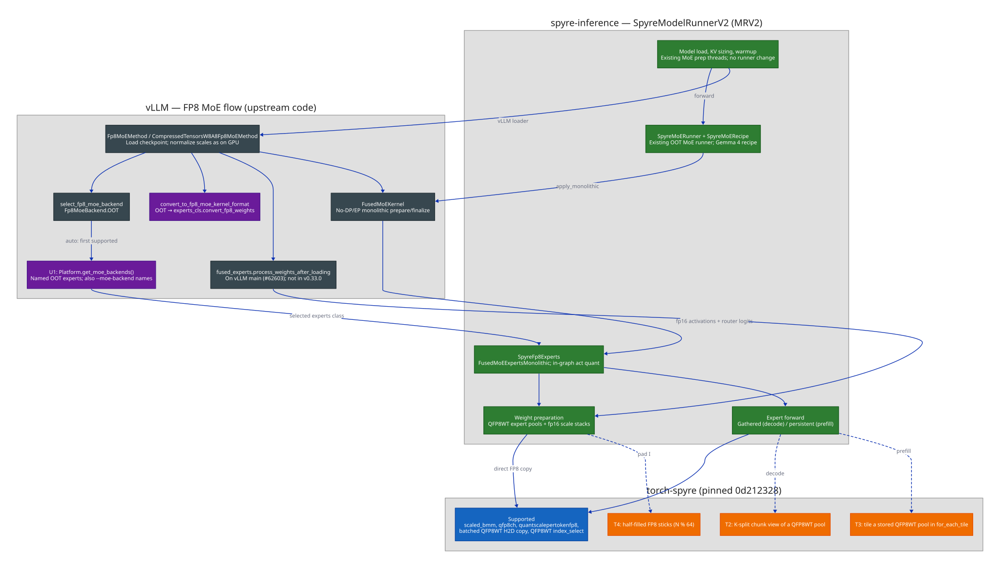
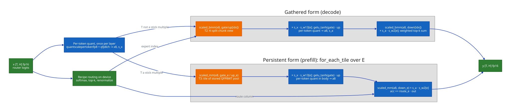

# RFC: FP8 routed experts on Spyre (Gemma 4 26B-A4B FP8)

| Field | Value |
|---|---|
| Status | Draft |
| Authors | Rehan Khan ([@R3hankhan123](https://github.com/R3hankhan123)), [@dilipgb](https://github.com/dilipgb), [@rishikakedia](https://github.com/rishikakedia) |
| Created | 2026-11-23 |
| Updated | 2026-11-26 |
| Tracking | This design: [#1803](https://github.com/torch-spyre/spyre-inference/pull/1803). vLLM hook: [vllm-project/vllm#68968](https://github.com/vllm-project/vllm/pull/68968) |
| Related | vLLM FP8 MoE oracle (`oracle/fp8.py`); `SpyreFp8LinearKernel`; FP8 paged attention; upstream work with Michael Going and Felix Marty (vLLM) in [vllm-project/vllm#68968](https://github.com/vllm-project/vllm/pull/68968) |

## 1. Motivation

The unquantized Gemma 4 26B-A4B runs on Spyre at TP=4. Dense FP8 layers run too:
`SpyreFp8LinearKernel` loads checkpoint FP8 directly into `QFP8WT` and runs `spyre.scaled_mm`.
An FP8 checkpoint of the MoE model still cannot load, for two reasons:

1. vLLM's FP8 MoE oracle has no out-of-tree path. On a platform other than CUDA or ROCm,
   `select_fp8_moe_backend` returns `Fp8MoeBackend.NONE` with no experts class, under a TODO asking
   for plugin registration, and `Fp8MoEMethod._init_moe_kernel` then asserts on the missing class.
2. spyre-inference's MoE backend implements only the unquantized method;
   `configure_spyre_moe_layer` rejects quantized experts.

The routed experts hold most of the model's parameters. Dequantizing them to fp16 at load would run,
but forgoes the point of FP8 for this model: half the expert weight memory and half the expert weight
bandwidth per decode step.

This RFC proposes three pieces of work:

1. **U — vLLM:** let an out-of-tree platform register named MoE experts with the FP8 oracle. This is
   platform-neutral, implemented, and open upstream as vllm#68968.
2. **A — spyre-inference:** a `SpyreFp8Experts` class that builds `QFP8WT` expert pools at load and
   runs both Spyre MoE forward forms with `spyre.scaled_bmm` / `scaled_mm`.
3. **T — torch-spyre:** the remaining `QFP8WT` lowering gaps those forms hit.

The design is model-agnostic. Gemma 4 supplies only its `SpyreMoERecipe`, as it does for fp16.

## 2. Goals and non-goals

### Goals

- Load and serve
  [`RedHatAI/gemma-4-26B-A4B-it-FP8-dynamic`](https://huggingface.co/RedHatAI/gemma-4-26B-A4B-it-FP8-dynamic)
  at TP=4 on `SpyreModelRunnerV2`, with routed experts stored and multiplied in FP8.
- Keep vLLM's FP8 MoE flow upstream code: its quant methods load and normalize the checkpoint as
  on GPU. Spyre supplies only an experts class, selected by the oracle.
- No Spyre-specific code in vLLM, and no long-lived patch: spyre-inference carries U1 only until a
  pinned vLLM release contains it.
- Match vLLM's reference quantization numerics (`QuantFP8.forward_native`).
- No model-runner change, no new warmup buckets, and no environment-variable switch. Selection is
  by the oracle, overridable with vLLM's existing `--moe-backend`.

### Non-goals

- Block-scaled FP8 experts (`weight_block_size`), online `--quantization fp8`, an FP8 router, and
  bf16 models (rejected at TP>1, §3.6).
- Expert parallelism, DP>1 and EPLB; Spyre rejects them for every MoE.
- Moving the unquantized Spyre MoE onto an experts class (§10, drawbacks).

## 3. Background: the pinned upstream contracts

**Version basis.** Source references were checked against spyre-inference main
`e417050b4ab8ac3d6ff38a2f52859cbdd6b19ec7`. Its `pyproject.toml` specifies
`vllm[grpc]>=0.33.0,<0.34`; `uv.lock` resolves tag `v0.33.0` to
`4ba787ec9959e566d3b587a796dff07673324da5`. The torch-spyre lock is
`0d212328a12cce9a35a28b1df7e50f82f06fda41`. Statements about vLLM `main` name the commit that
introduced them. These are source checks, not hardware qualification of that combination.

### 3.1 Target checkpoint

Google publishes no FP8 release of this model. The target was produced by LLM Compressor
`model_free_ptq` with the `FP8_DYNAMIC` scheme:

| Property | Value |
|---|---|
| Format | compressed-tensors, `float-quantized` |
| Weights | FP8 e4m3, static, symmetric, **per output channel** (`kFp8StaticChannelSym`) |
| Activations | FP8 e4m3, **dynamic per token** (`kFp8DynamicTokenSym`) |
| Quantized | every text-decoder `Linear`: 24.5B FP8 parameters, of which the experts are 30 layers × 128 experts × 3 × 2816 × 704 ≈ 22.8B |
| Kept bf16 | `router.proj`, embeddings, `lm_head`, the vision tower |
| vLLM method | `CompressedTensorsW8A8Fp8MoEMethod` (experts), `CompressedTensorsW8A8Fp8` (dense linears) |

The dense FP8 linears, attention projections and Gemma 4's dense MLP beside the MoE, already run
through `SpyreFp8LinearKernel`. This RFC covers only the routed experts.

### 3.2 MoE shapes

| Dim | Value | Per rank at TP=4 | Stick fit |
|---|---|---|---|
| hidden `H` | 2816 | 2816 | 22 FP8 sticks of 128; even, so `QFP8WT` K-pairs fit |
| experts `E` | 128 | 128 (TP shards I, not E) | leading dim, outside the stick |
| top-k | 8 | 8 | |
| expert intermediate `I` | 704 | 176 | pads to 256 on a full FP8 stick, or 192 with half sticks (T4) |
| layers | 30 | 30 | |

Per rank, `w13` is `[128, 352, 2816]` and `w2` is `[128, 2816, 176]`, with fp32 scales
`[128, 352, 1]` and `[128, 2816, 1]`. The `w13` scale shards with I; the `w2` scale is per output
channel of H and is not sharded.

### 3.3 Load path in vLLM v0.33.0

For a per-channel checkpoint, `CompressedTensorsW8A8Fp8MoEMethod.process_weights_after_loading`
does no math on the weights:

1. `normalize_e4m3fn_to_e4m3fnuz`: ROCm only.
2. `process_fp8_input_tensor_strategy_moe`: static input scales only; skipped for dynamic.
3. `process_fp8_weight_tensor_strategy_moe`: per-tensor weights only; skipped for channel.
4. `convert_to_fp8_moe_kernel_format`: per-backend layout conversion; the results replace the
   layer's parameters through `replace_parameter`, which re-registers on a shape or type change.
5. `_init_moe_kernel` → `make_fp8_moe_kernel`.

spyre-inference builds vLLM with `VLLM_TARGET_DEVICE=empty`, so no `torch.ops._C` or
`torch.ops._moe_C` op exists. Formats that reach a C op at load therefore fail before any Spyre code
runs:

| Checkpoint format | Load-time op | Loads on Spyre's vLLM build |
|---|---|---|
| compressed-tensors channel × dynamic token (**target**) | none | **Yes** |
| compressed-tensors per-tensor, static or dynamic | step 3 requantizes w1/w3 to their max scale via `ops.scaled_fp8_quant` → `_C.static_scaled_fp8_quant` | No; needs U2 |
| `quant_method: fp8` (`Fp8MoEMethod`), not block-scaled | same requantization | No; needs U2 |
| block-scaled 128×128 | none, but `SpyreFp8Experts` rejects it | No; out of scope |
| online `--quantization fp8` | `ops.scaled_fp8_quant` per expert | No; out of scope |

### 3.4 Forward path in vLLM, and the Spyre replacement

On CUDA the oracle picks a modular experts class such as `TritonExperts`. Each step, next to what
`SpyreFp8Experts` runs instead:

| # | Step | vLLM op (CUDA) | Math | Spyre | torch-spyre at the pin |
|---|---|---|---|---|---|
| 1 | Router logits | `GateLinear` | `proj(rmsnorm(x) · H^-½ · scale)` | unchanged fp16 path | supported |
| 2 | Routing | `gemma4_fused_routing_kernel_triton` | softmax over 128, top-8, renormalize, × `per_expert_scale[e]` | recipe routing on device; `per_expert_scale` folded into the `w2` scale (§6.3) | supported |
| 3 | Input quant | `_C.dynamic_per_token_scaled_fp8_quant` | `s_x = max(amax(x_t)/448, 1/(448·512))`, `x8 = sat_e4m3(x/s_x)` | `quantscalepertokenfp8` + `qfp8ch`, once per layer | supported |
| 4 | Token sort | `_moe_C.moe_align_block_size` | sort (token, expert) pairs, pad to block M | none: gathered reads by index, persistent loops over experts | not needed |
| 5 | GEMM1 | `invoke_fused_moe_triton_kernel` | `(x8 · w13_e) · s_x[t] · s_w13[e, n]` | `scaled_bmm` (gathered) / `scaled_mm` in `for_each_tile` (persistent); fp16 epilogue | T2, T3 |
| 6 | Activation | `_C.gelu_tanh_and_mul` | `gelu_tanh(gate) · up` | fp16 elementwise | supported |
| 7 | Intermediate quant | `_C.dynamic_per_token_scaled_fp8_quant` | as step 3, on `[T·8, I]` | per-token quant in the graph | supported |
| 8 | GEMM2 + route weight | same kernel, `MUL_ROUTED_WEIGHT` | `(a8 · w2_e) · s_a[t] · s_w2[e, h] · w_route[t, e]` | `scaled_bmm` / `scaled_mm`; epilogue × route | T2, T3 |
| 9 | Top-k reduce | `_moe_C.moe_sum` | sum over 8 experts | weighted sum / loop accumulator | supported |

Consequences:

- **Every forward op is replaced; none is ported.** Steps 3–9 are Triton or vLLM C kernels, so
  `SpyreFp8Experts` is monolithic, sets `expects_unquantized_inputs`, and owns steps 2–9.
- **Quantization numerics follow `QuantFP8.forward_native`**: per-token amax / 448, minimum scale
  1/(448·512), saturating cast. The minimum matters on Spyre: zero-padded token rows in a
  stick-aligned bucket would otherwise get scale 0 and quantize to NaN.
- **Scales are fp32 on GPU and fp16 on Spyre.** Channel weight scales sit well inside fp16's range.
  The activation-scale floor is subnormal in fp16, which affects only rows that are all near zero.

### 3.5 Model runner

spyre-inference has one model runner, `SpyreModelRunnerV2`, its port of vLLM's MRV2; the V1 runner
was removed in #1725. MRV2's MoE-specific hooks cover DP, EP all-to-all, EPLB and microbatching,
which Spyre rejects, so FP8 experts change no runner code (§6.5).

### 3.6 What changed since the first draft of this RFC

| Earlier assumption | Verified contract / design consequence |
|---|---|
| Platform hook `get_moe_experts_cls() -> list[type]` | vllm#68968 (with Felix Marty's revision) uses `Platform.get_moe_backends() -> dict[str, type[FusedMoEExperts]]`. Names join `--moe-backend`; `auto` tries them in order ahead of in-tree backends. |
| `convert_to_fp8_moe_kernel_format` is identity for `OOT` | It calls `experts_cls.convert_fp8_weights(...)`, a new `FusedMoEExperts` static method whose default is identity. Spyre builds its pools there (§6.3). |
| `fused_experts.process_weights_after_loading` is called by every FP8 MoE method upstream | True on vLLM main since vllm#62603, **not** in v0.33.0. The design no longer depends on it: `convert_fp8_weights` runs on the pin with U1 alone. |
| ModelOpt FP8 needs a hook fix in the U1 PR | Dropped from vllm#68968; ModelOpt FP8 is not a target. |
| T1, 3-D `QFP8WT` host-to-device copy, is a blocker | Landed in torch-spyre#5178 (at the pin): rank 2–4 `QFP8WT` transfers with per-matrix offsets, including `dev[b]` views. Only the 2-D `model_utils` helper remains, and the fp16 → `qfp8wt` interim load is a fallback, not the plan. |
| T2 indexed gathers of `QFP8WT` are untested | `index_select` on a leading dim preserves `QFP8WT` and feeds `scaled_bmm` (FP8 paged-attention tests). The K-splitting chunk view remains untested. |
| V1 runner removed in #1245 | Removed in #1725. |

## 4. Device contract and current torch-spyre

`QFP8WT` packs a `[K, N]` weight in `[2, 64]` sticks: K in pairs, N in strips of 64. Its batched
device order at the pin is `[outer batch] [N-strip] [last batch] [K/2] [stick]`. A pool copied from
host and a pool produced by a compiled `spyre.qfp8wt` must be interchangeable as `scaled_bmm`
operands; §12 tests that rather than assuming it from matching shapes.

| Ask | Status at the pin | Needed by |
|---|---|---|
| T1. Batched `QFP8WT` host-to-device copy | **Supported** (torch-spyre#5178, `TestFp8Qfp8wtBatchTransfer`; see §4.1). Optional: a 3-D `model_utils` helper | §6.3 |
| T2. Views and gathers on a `QFP8WT` pool | `index_select` along E **supported**. A chunk view `[E, C, F] → [E·chunks, C/chunks, F]` that splits K (with `C/chunks` even) is **untested** | gathered form, §6.4 |
| T3. Tile a stored `QFP8WT` pool in `for_each_tile` | **Untested.** Loop-invariant FP8 operands and operands quantized in the body work; FP8 attention quantizes in the body, so no stored `QFP8WT` tensor has been tiled. Request: tile size 1 along a dim outside the stick, keeping the arrangement | persistent form, §6.4 |
| T4. Half-filled FP8 sticks (N % 64) | **Not supported**: layout propagation pads N to 128. Today a half stick fails (`batchmatmulfp8: cannot restickify any input layout`) or, for 4-D Q·Kᵀ, returns infs; the minimum ask is an error | efficiency only |

T4 decides how much of FP8's saving Gemma 4 keeps. At TP=4, I=176 pads to 256 on a full FP8 stick,
45% zero lanes in every expert matmul. With half sticks it pads to 192, 9%, the same padding as fp16.
T4 does not block correctness.

Fallbacks, if an ask cannot be met: for T2, gather an fp16 copy and run `qfp8wt` per step; for T3,
run prefill through the gathered form. Both are correct and cost bandwidth; neither is silent. The
experts class picks the form by bucket, and an unsupported combination fails at warmup.

### 4.1 T1: how torch-spyre#5178 loads 3-D expert stacks

[torch-spyre#5178](https://github.com/torch-spyre/torch-spyre/pull/5178) was written for the FP8 KV
cache, but it changed the general `QFP8WT` host↔device data-conversion path in
`torch_spyre/csrc/spyre_mem.cpp`. An expert stack `[E, K, N]` has the same shape as a paged cache
`[num_blocks, K, N]`, so the expert load inherits it.

**Before.** The `QFP8WT` conversion handled 2-D tensors only. It read just the last two host dims
(K, N) and set the device offset of a host-to-device copy to 0. Copying expert by expert into
`dst[e]` therefore overwrote expert 0, and a whole `[E, K, N]` stack had no batch handling.

**After.** At the pin:

1. **Leading batch dims.** Rank 2–4 tensors are accepted. The copy emits one
   `DataConversionStrideInfo` per `[K, N]` matrix, each with the `[2, 64]` stick interleave
   `scaled_bmm` expects for its weight operand, so one call copies all E matrices.
2. **Per-matrix device offsets.** On the device the matrices interleave with their N-strips:
   `[outer batch] [N-strip] [last batch] [K/2] [stick]`. Each matrix's offset is computed from the
   allocation's batch geometry, so a whole-stack copy places every expert correctly.
3. **Views honored.** The destination view's storage offset and strides are used, so
   `pool[e].copy_(host_e)` lands on expert e and the stack can be loaded one expert at a time. A view
   that does not start on a whole `[K, N]` matrix, or has non-whole-matrix batch strides, is
   rejected instead of written to the wrong place.
4. **Non-contiguous host tensors.** Host elements are addressed through the host tensor's own
   strides. The checkpoint stores `[E, N, K]` (output × input); a `.transpose(-2, -1)` view can go
   straight into the copy, with no `.contiguous()` host copy.

**Use in §6.3.** Per layer: split w13 into gate and up, transpose as views, zero-pad I on the host
(176 → 256; the copy requires `N % 64 == 0` and even K), allocate an empty `QFP8WT` device pool, and
`copy_` the FP8 bytes in. There is no fp16 copy, no compiled `qfp8wt`, and no transient device
memory beyond the pool itself.

**Not settled by #5178:**

- **Copy vs compiled order at rank 3.** The copy's device order is `[N-strip] [E] [K/2] [stick]`.
  A compiled `spyre.qfp8wt` defaults to `qfp8wt_dim_order(3)`, i.e. `[E] [N-tile] [K] [stick]`, and
  layout propagation may reorder it when a matmul reads the tensor. No test yet feeds a host-copied
  3-D weight pool to `scaled_bmm` (§10 question 5; first spyre-inference gate in §12).
- **Python helper.** `torch_spyre/model_utils.py` still asserts `weight.ndim == 2`. spyre-inference
  allocates the pool and calls `copy_` itself unless torch-spyre adds a 3-D helper.
- **Coverage.** #5178's `TestFp8Qfp8wtBatchTransfer` and `TestFp8Qfp8wtSliceCopy` use KV-cache
  shapes. Expert shapes such as `[128, 2816, 256]` have not run on hardware.

## 5. Proposed architecture



Diagram sources: [D2](figures/spyre-fp8-moe-arch.d2), [Mermaid](figures/spyre-fp8-moe-arch.mmd).

vLLM owns checkpoint loading, scale normalization, backend selection and the modular-kernel
plumbing. spyre-inference owns one experts class, its weight layout and its two forward forms, all
inside the existing MRV2 load, KV sizing and warmup steps. torch-spyre owns the `QFP8WT` layout,
copies and FP8 matmul lowering.

## 6. Component design

### 6.1 U1: named out-of-tree MoE backends (vLLM)

Implemented on the `fp8-oot` branch and open upstream as
[vllm#68968](https://github.com/vllm-project/vllm/pull/68968), with Felix Marty's revision merged:

```python
# vllm/platforms/interface.py
@classmethod
def get_moe_backends(cls) -> dict[str, type["FusedMoEExperts"]]:
    """Out-of-tree MoE backends by `--moe-backend` name, in the priority
    order used by `auto`. Names are lowercase with underscores and must not
    reuse an in-tree backend's."""
    return {}
```

- `MoEKernelOracle` gains `oot_backend`, `get_oot_backends()` and `select_oot_backend()`. The FP8
  oracle sets `oot_backend = Fp8MoeBackend.OOT` and consults it before in-tree selection.
- `--moe-backend auto` tries each registered class through the existing `try_backend` /
  `is_supported_config` path; the first that accepts wins. If all reject, one warning lists each
  name and reason, and selection falls through to the in-tree path, which returns `NONE` off
  CUDA/ROCm as before.
- An explicit `--moe-backend <name>` must support the layer or raise. `MoEBackend` becomes
  `InTreeMoEBackend | str`, validated against both sets; a platform name colliding with an in-tree
  one is an error.
- `convert_to_fp8_moe_kernel_format` dispatches `OOT` to `experts_cls.convert_fp8_weights`. Every
  FP8 MoE method (`Fp8MoEMethod`, compressed-tensors W8A8, ModelOpt, online, Quark) passes its
  selected `experts_cls`.

Spyre registers one backend:

```python
@classmethod
def get_moe_backends(cls):
    return {"spyre": SpyreFp8Experts}
```

Currently only FP8 MoE layers consult the registry; the unquantized oracle keeps its own `OOT`.

**Upstream status.** U1 is
[vllm-project/vllm#68968](https://github.com/vllm-project/vllm/pull/68968), "\[MoE\]\[FP8\] Let
out-of-tree platforms register FP8 MoE experts", opened 2026-11-20 and under review. The upstream
work is done with Michael Going and Felix Marty on the vLLM side; Felix's revision moved the hook
from a list of classes to named backends shared with `--moe-backend`. The PR is platform-neutral and
mentions no Spyre code. It resolves the FP8 oracle's TODO asking for MoE backend registration by
out-of-tree plugins, which the TPU plugin can use as well. Its tests in
`tests/kernels/moe/test_moe_kernel_oracle.py` cover the U1 acceptance criteria in §12.
spyre-inference carries the same change as a narrow patch only until a pinned vLLM release contains
the PR (§7, S0).

### 6.2 U2: per-tensor requantization without C ops (vLLM, optional)

`process_fp8_weight_tensor_strategy_moe` requantizes w1 and w3 to their shared max scale through
`ops.scaled_fp8_quant`, which has no fallback when `_C` is absent. Proposal: quantize through
`QuantFP8(static=True, group_shape=GroupShape.PER_TENSOR)`, whose `forward_native` is exact torch
math. It runs once per layer at load on the host. U2 is not on the target's path and is raised only
when a per-tensor FP8 MoE checkpoint becomes a target.

### 6.3 `SpyreFp8Experts` and weight preparation

A `FusedMoEExpertsMonolithic` subclass: it takes router logits and routes on the device, like the
existing Spyre MoE. It sets `expects_unquantized_inputs = True`, so the no-DP/EP prepare step passes
fp16 activations through.

| `is_supported_config` piece | Accepts |
|---|---|
| device | Spyre |
| quant scheme | FP8 e4m3 per-channel weights × dynamic per-token activations (target). Per-tensor weights with per-tensor activations are accepted, but load only after U2. Never block-scaled |
| activation | the activations Spyre recipes implement (`gelu_tanh`, `swigluoai`) |
| parallel config | TP only: no EP, DP, PCP, SP or EPLB |
| routing | custom (recipe) routing, top-k softmax, fp16 logits |

**Weight preparation runs in `convert_fp8_weights`**, after vLLM's own normalization (§3.3, step 4).
Its returned tensors replace the layer's parameters, so it works on v0.33.0 with only U1, without
vllm#62603's experts hook:

1. Split w13 into gate and up, transpose each to `[E, K, N]`, and zero-pad the TP-sharded I to the
   FP8 stick (128 until T4, then 64). Padding stays inert: padded gate/up columns are zero and meet
   zero rows of the down stack.
2. Copy each FP8 stack directly into a `QFP8WT` device pool (T1, supported). No fp16 copy is made.
3. Convert scales to fp16 `[E, 1, N]` stacks. Fold the recipe's per-expert down scale into the `w2`
   scale through a new recipe hook, `prepare_down_scale`. It is exact because Gemma's
   `per_expert_scale` multiplies the down projection's output per expert. An FP8 layer whose recipe
   only defines `prepare_down_weight` is rejected.
4. Return the pools and scale stacks. Gate and up travel as one w13 pool, split at a stick-aligned
   column block; if that column view does not lower, they are kept as two pools on the layer (§10).

The checkpoint FP8 parameters are released once replaced, so nothing moves twice in
`move_model_to_spyre`. That is the same contract `SpyreFp8LinearKernel` relies on.

Everything upstream does stays upstream. For per-tensor checkpoints with separate w1/w3 scales,
vLLM requantizes both to the max, as on GPU, and Spyre reads the normalized parameters.
`SpyreMoERunner` calls `quant_method.apply_monolithic`, which reaches `SpyreFp8Experts.apply`
through `FusedMoEKernel`. `configure_spyre_moe_layer` accepts a layer whose FP8 method selected
`SpyreFp8Experts` and still rejects other quantized methods.

### 6.4 Forward forms



Diagram sources: [D2](figures/spyre-fp8-moe-forward.d2), [Mermaid](figures/spyre-fp8-moe-forward.mmd).

The activation is quantized once per layer. The forms and their dispatch are the fp16 MoE's:

- **Gathered (decode).** Reads each selected expert by index and runs one batched matmul per
  projection: `scaled_bmm(x8, gate[idx])`, `[rows·c, 1, H/c] × [rows·c, H/c, I]`. The chunk view
  splits K, which `QFP8WT` packs in pairs, so `_derive_moe_chunks` gains an even `H / chunks`
  constraint for FP8 (T2). Scale gathers reuse the fp16 `[E, 1, N]` gather already used for biases.
- **Persistent (prefill).** `for_each_tile` over E with tile size 1. Every token meets every expert,
  weighted by its route column. Gate/up on `x8` is a loop-invariant FP8 operand; the down projection
  on `a8`, quantized in the body, is supported since the FP8 attention P·V fix. The open gap is that
  every weight operand is a tile of a stored `QFP8WT` pool (T3).

`SpyreMoERunner` traces stick-multiple token counts into the block graph, which is the persistent
form. Other counts go through the opaque `moe_forward` op and its compiled regions.

### 6.5 MRV2 integration

No runner code changes. The FP8 design fits the existing steps:

- **Load.** `_SpyreModelLoaderWrapper.load_model` wraps vLLM's loader in
  `prepare_moe_layers_on_threads()`. `convert_fp8_weights` runs inside vLLM's
  `process_weights_after_loading`, so FP8 layers get the threaded preparation. Leaving the context
  waits for every layer and re-raises the first failure.
- **KV cache sizing.** The runner sizes the KV cache from free device memory after load. The direct
  copy leaves no transient fp16 copy to shrink it; §12 asserts that.
- **Warmup.** `warmup.plan` runs MRV2's `_dummy_run` at every token bucket with `is_profile=True`,
  which routes dummy tokens to experts. Every FP8 block graph and gathered region is therefore
  traced before serving. The FP8 forms add no buckets, but each traced shape compiles FP8 kernels,
  so startup time is a tracked metric.
- **Startup checks.** `_reject_unsupported_v2_features` needs nothing new;
  `is_supported_config` already refuses EP, DP and EPLB.

### 6.6 Selection and configuration

Selection is automatic: with `--moe-backend auto`, the default, the oracle tries `spyre` first on
Spyre. `--moe-backend spyre` forces it and fails loudly if the layer is unsupported. No environment
variable or Spyre-specific flag is added.

```bash
vllm serve RedHatAI/gemma-4-26B-A4B-it-FP8-dynamic --tensor-parallel-size 4
```

This is the implementation target. The pinned vLLM does not contain U1, so until it does,
spyre-inference applies U1 as a narrow patch from the platform plugin (§7).

## 7. Implementation plan

| Stage | spyre-inference work | Lower-layer prerequisites |
|---|---|---|
| S0 | Carry U1 as a narrow patch on vLLM v0.33.0 until a pinned release contains vllm#68968; run the oracle tests in the upstream tier | vllm#68968 review, coordinated with Michael Going and Felix Marty |
| S1 | `SpyreFp8Experts` selection and rejections; `convert_fp8_weights` building pools through the direct `QFP8WT` copy; recipe `prepare_down_scale` | T1 (supported) |
| S2 | Gathered decode form with FP8 chunk constraint | T2 chunk view, or its fallback |
| S3 | Persistent prefill form | T3, or prefill through the gathered form |
| S4 | Gemma 4 FP8 end-to-end at TP=4; model config entry | S1–S3 |
| S5 | Pad I to 64 instead of 128 | T4 |
| S6 (optional) | none | U2, only for a per-tensor target |

S2 and S3 run on a card as soon as S1 lands; those first runs show whether T2 and T3 need
torch-spyre changes at all. The U1 patch is deleted at the first vLLM bump containing vllm#68968.
Change dependency pins only in implementation PRs with matching builds and hardware qualification.
This RFC adds no runtime code.

## 8. Compatibility with other formats and features

- **Other FP8 MoE checkpoints** with per-channel weights and dynamic per-token activations need only
  a `SpyreMoERecipe`. Per-tensor checkpoints load after U2. Block-scaled checkpoints fall back to
  `Fp8MoeBackend.NONE` with a logged reason, not a wrong answer.
- **Unquantized MoE** keeps its current path through `UnquantizedMoeBackend.OOT`, unchanged.
- **FP8 KV cache and FP8 attention** are independent of the experts. An FP8 checkpoint defaulting to
  an FP8 KV cache is decided by the KV-cache configuration, not here.
- **KV offloading** (`upstream-connector-port.md`) is unaffected: experts do not touch KV pages.
  Smaller expert pools leave more device memory for KV blocks, and offload's compatibility identity
  already includes the model revision and quantization.

## 9. Alignment with the working prototypes

| Branch / inspected tip | Implemented shape | Boundary still to close |
|---|---|---|
| vLLM `fp8-oot` / `7fc8c7cd9abdd2846965dde3f8bab141ea0b0cff` (vllm#68968) | `get_moe_backends`, oracle OOT selection with warning on full rejection, `--moe-backend` name validation, `convert_fp8_weights` dispatch from every FP8 MoE method; unit tests in `tests/kernels/moe/test_moe_kernel_oracle.py` | Upstream review; rebase onto the vLLM release spyre-inference pins |
| torch-spyre pin `0d212328` | Batched `QFP8WT` transfers, `QFP8WT`-preserving `index_select`, `scaled_bmm` on gathered pages, FP8 in `for_each_tile` on loop-invariant and in-body operands | T2 chunk view, T3 stored-pool tiling, T4 half sticks |
| spyre-inference | none yet | all of §6.3–§6.5 |

No hardware test was run for this revision. The FP8 KV-cache tests exercise the torch-spyre
evidence above, not expert pools.

## 10. Open questions and resolved review points

1. **Hook shape — resolved for now.** The first draft's `get_moe_experts_cls() -> list` became
   `get_moe_backends() -> dict` in review, so names double as `--moe-backend` values. Final naming
   is settled on vllm#68968; a TPU plugin may want the same hook.
2. **Gate/up layout.** One w13 pool viewed at a stick-aligned column block, or two pools stored on
   the layer? It depends on whether an N-block view of a `QFP8WT` pool lowers as a `scaled_bmm`
   operand.
3. **T2.** Can the K-splitting chunk view keep `QFP8WT`, or does the gathered form need a different
   chunking for FP8 given the even `H / chunks` constraint and the larger stick?
4. **T3.** Can `for_each_tile` slice a stored `QFP8WT` pool along E with tile size 1?
5. **Copy/compile interchangeability.** Is a host-copied pool byte-identical in arrangement to a
   compiled `qfp8wt` output of the same shape at rank 3? §12 tests this before relying on it.
6. **Scale normalization.** vLLM requantizes per-tensor w1/w3 to their max scale. Spyre splits gate
   from up anyway and could keep separate scales, but accepting vLLM's normalization keeps one set
   of numerics across platforms.

**Alternatives considered:**

- *Swap the quant method in spyre-inference* via `RoutedExperts._replace_quant_method`, marked a
  temporary hack upstream. It needs no vLLM change, but duplicates upstream FP8 MoE logic and breaks
  silently when that logic changes. Rejected in favor of U1.
- *A Spyre subclass of vLLM's FP8 quantization config.* Rejected: it forks the config and method
  classes.
- *Dequantize experts to fp16 at load.* No device work, but no memory or bandwidth benefit. Kept as
  the fallback if T2 and T3 both fail.
- *FP8 for decode only, fp16 for prefill.* Rejected: it holds both copies of every expert.

**Drawbacks.** spyre-inference ends up with two MoE integration styles, unquantized through a
`CustomOp` and FP8 through an experts class. Shared helpers (routing, chunking, the expert loop body
with an optional scale epilogue) keep the FP8 code thin. Until T4, FP8 pads I further than fp16 for
awkward shard sizes.

## 11. Out of scope and follow-ups

- Block-scaled FP8 experts, online `--quantization fp8`, an FP8 router, bf16 models.
- U2, until a per-tensor FP8 MoE checkpoint becomes a target.
- Moving the unquantized Spyre MoE onto an experts class registered through `get_moe_backends`.
- An `oot` value for the unquantized oracle's `--moe-backend`, unifying both registries.
- Documentation: `get_moe_backends` in vLLM's plugin guide (part of vllm#68968); `SpyreFp8Experts`
  in `docs/architecture/index.md`; the FP8 checkpoint in the supported-model table; `QFP8WT` batch,
  view, gather and tiling support in torch-spyre's docs.

## 12. Acceptance criteria

These are implementation gates, **not test results for this docs-only PR**. Hardware tests run
sequentially on a contested card.

### vLLM (U1)

- [ ] A fake out-of-tree platform's first supporting backend is selected under `auto`; an explicit
  `--moe-backend <name>` selects it or raises; an unknown or colliding name is rejected.
- [ ] When every registered class rejects a layer, one warning lists each name and reason, and
  selection falls back as before.
- [ ] `convert_fp8_weights` receives the selected class from every FP8 MoE method; the default is
  identity.

### spyre-inference: selection and load

- [ ] On Spyre, the target checkpoint selects `spyre`. Block-scaled, bf16, EP and DP configurations
  fall back to `Fp8MoeBackend.NONE` with a clear reason.
- [ ] A random FP8 `[E, K, N]` stack copied into a `QFP8WT` pool, whole and per expert, gives
  `scaled_bmm` results matching a CPU reference. A device-to-host round trip returns the same bytes.
  The pool matches a compiled `qfp8wt` of the same shape as a matmul operand.
- [ ] After load, the experts' device memory equals the FP8 pools plus the fp16 scale stacks, with
  no fp16 weight copy left to shrink the KV cache.
- [ ] Folding `per_expert_scale` into the `w2` scale matches the fp16 recipe's
  `prepare_down_weight` result within FP8 rounding.

### spyre-inference: numerics and forms

- [ ] In-graph activation quantization matches `QuantFP8.forward_native`, including the minimum
  scale on zero-padded rows (no NaN).
- [ ] FP8 variants of the gathered and persistent tests in `tests/models/test_gemma4_moe.py` match a
  CPU reference that dequantizes the FP8 weights and emulates activation quantization, within about
  2% relative, as in the FP8 attention tests.
- [ ] Every warmup bucket compiles. An unsupported form fails at warmup, not in serving.

### End to end

- [ ] `RedHatAI/gemma-4-26B-A4B-it-FP8-dynamic` at TP=4 passes `tests/e2e/test_model_quality.py`
  under the existing FP8 decoder rules, against the unquantized sibling's references.
- [ ] Report, as % change against unquantized Gemma 4 26B-A4B at the same serving config: expert
  weight memory (target about half), decode TPOT, prefill TTFT, and startup time split into load
  and warmup.
- [ ] The unquantized MoE path and non-MoE FP8 models are unchanged.
- [ ] Once a pinned vLLM contains vllm#68968, the U1 patch is zero lines.

## 13. References

**spyre-inference main at the version basis in §3:**

- `spyre_inference/platform.py`: `TorchSpyrePlatform`, where `get_moe_backends` is added.
- `spyre_inference/v1/worker/spyre/`: `SpyreModelRunnerV2`; `load.py` holds
  `_SpyreModelLoaderWrapper`.
- `spyre_inference/moe.py`: `SpyreMoERunner`, `SpyreMoERecipe`, `prepare_moe_layers_on_threads`,
  `_derive_moe_chunks`, `prepare_down_weight`.
- `spyre_inference/custom_ops/fp8_linear_kernel.py`: `SpyreFp8LinearKernel`.
- `spyre_inference/models/gemma4.py`: the Gemma 4 recipe.

**vLLM [v0.33.0](https://github.com/vllm-project/vllm/tree/4ba787ec9959e566d3b587a796dff07673324da5):**

- `vllm/model_executor/layers/fused_moe/oracle/{base,fp8}.py`: `MoEKernelOracle`,
  `select_fp8_moe_backend`, `convert_to_fp8_moe_kernel_format`.
- `vllm/model_executor/layers/fused_moe/modular_kernel.py`: `FusedMoEExperts`,
  `FusedMoEExpertsMonolithic`.
- `vllm/model_executor/layers/quantization/compressed_tensors/compressed_tensors_moe/compressed_tensors_moe_w8a8_fp8.py`,
  `vllm/model_executor/layers/quantization/fp8.py`: FP8 MoE methods.
- `vllm/model_executor/layers/quantization/utils/fp8_utils.py`: `process_fp8_weight_tensor_strategy_moe`.
- `vllm/model_executor/layers/quantization/input_quant_fp8.py`: `QuantFP8.forward_native`.
- `vllm/model_executor/models/gemma4.py`: Gemma 4 routing.

**vLLM after the pin:** vllm#68968 (U1, open), vllm#62603 (experts hook in FP8 MoE methods, on main).

**torch-spyre [pinned source](https://github.com/torch-spyre/torch-spyre/tree/0d212328a12cce9a35a28b1df7e50f82f06fda41):**

- `torch_spyre/csrc/spyre_mem.cpp`: batched `QFP8WT` data-conversion info.
- `torch_spyre/_inductor/propagate_layouts.py`: `qfp8wt_dim_order`, `_qfp8wt_stl`.
- `torch_spyre/model_utils.py`: 2-D `QFP8WT` load helper.
- `tests/inductor/test_fp8_paged_attention.py`: `QFP8WT` batch transfer, slice copy, gather and
  `scaled_bmm` tests.
- `tests/inductor/test_for_each_tile_e2e.py`: FP8 matmuls inside `for_each_tile`.

**Related design:** [Port the upstream KV Connector experience](upstream-connector-port.md), the
format this RFC follows.
