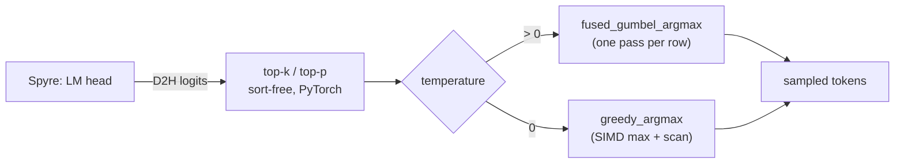
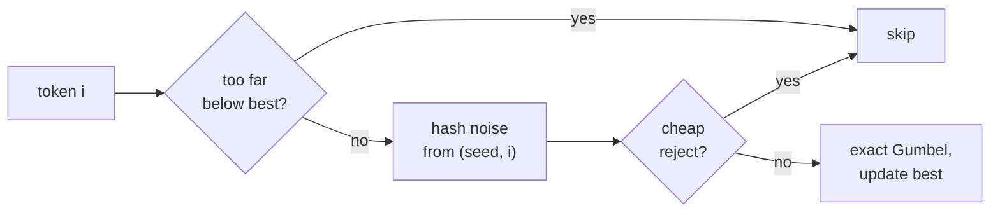

# RFC: Host-side sampling kernels

| Field | Value |
|---|---|
| Status | Implemented |
| Authors | Rehan Khan ([@R3hankhan123](https://github.com/R3hankhan123)), Rishika Kedia ([@rishikakedia](https://github.com/rishikakedia)), Dilip Gowda Bhagavan ([@dilipgb](https://github.com/dilipgb)) |
| Created | 2026-11-03 |
| Updated | 2026-11-03 |
| Tracking | [#1111 — Reuse CPU sampling kernels from vLLM](https://github.com/torch-spyre/spyre-inference/pull/1111) |
| Related | vLLM CPU backend `csrc/cpu/sampling_kernels.cpp`; [vllm#59786](https://github.com/vllm-project/vllm/issues/59786) (Gumbel table bias) |

## 1. Motivation

Spyre cannot sample on the card, so `SpyreLogitsProcessor` copies the logits to the host and
every sampling step runs on the host CPU, serially between device forward passes. Its cost adds
directly to time per output token.

`TorchSpyrePlatform` is `PlatformEnum.OOT`, so `is_cpu()` is `False`, and vLLM's
`TopKTopPSampler` takes `forward_native`: eager PyTorch, without the fused kernels upstream
reserves for `forward_cpu`. For a batch of `B` rows and a vocabulary of `V` tokens, that path:

- **Random sampling:** fills a fresh `[B, V]` exponential noise tensor, then subtracts, takes
  the log and reduces it, each as a separate pass over memory. At `V = 262144` the fp32 noise
  alone is 1 MB per row, generated on every step.
- **Greedy sampling:** runs an eager `torch.argmax` over all `B × V` logits.

With large vocabularies (gemma-4: 262k tokens) and high concurrency, this was a large share
of each decode step.

## 2. Goals and non-goals

### Goals

- Make random and greedy sampling on the host a single pass over the logits, with no
  `[B, V]` temporaries.
- Sample exactly from `softmax(logits)`, including the tail of a large vocabulary.
- Keep seeded requests reproducible.
- Run vector code on every host ISA spyre-inference ships on: x86_64, ppc64le and s390x.
- Never make the kernels a hard requirement: if they are missing, sampling falls back to
  PyTorch with the same distribution.

### Non-goals

- Sampling on the Spyre device. That needs torch-spyre support for `topk`, sort and
  random-number ops.
- Changing user-facing sampling parameters or adding flags.
- Token-for-token parity with stock vLLM for random sampling.

## 3. Background: the sampling path on Spyre

`TorchSpyreModelRunner.__init__` patches upstream's `Sampler` in place after
`super().__init__()`:

```python
self.sampler.topk_topp_sampler = SpyreTopKTopPSampler(
    self.sampler.logprobs_mode, self.sampler.use_fp64_gumbel
)
self.sampler.greedy_sample = greedy_sample
```

Patching the instance, rather than swapping the class, means every holder of that sampler
(the rejection sampler included) samples the same way.

`SpyreTopKTopPSampler.forward_native` mirrors the tail of upstream's
`TopKTopPSampler.forward_native` with two changes:

1. **Sort-free top-k + top-p** (`apply_top_k_top_p_sort_free`): top-p only ever keeps top-k
   survivors, so it runs on a `topk` window of `2 × max_k` instead of a full-vocabulary sort.
   The window widens to the exact tie count when ties run past it. Top-k alone uses upstream's
   `allow_cpu_sync=True` path; top-p alone still sorts.
2. **The draw** goes to the fused Gumbel-max kernel described below.

## 4. Design

Both kernels live in `csrc/cpu/sampling_kernels.cpp` and register under
`torch.ops._spyre_C`. They take fp32, 2-D, CPU logits.



### 4.1 Random sampling: fused Gumbel-max

**Gumbel-max trick.** If `g_i ~ Gumbel(0, 1)` independently, then `argmax_i(x_i + g_i)` is
distributed exactly as `softmax(x)`. Adding a constant to every logit doesn't change the
argmax, so no softmax or normalization is needed.

**Hashed noise.** The kernel never stores noise. For row seed `s` and token `i`:

```text
key  = splitmix64(s)
bits = splitmix64(key + (i + 1) · 0x9E3779B97F4A7C15) >> 11     # 53 bits
u    = (bits + 0.5) · 2^-53                                     # in (0, 1)
g_i  = -log(-log u)
```

Each token gets independent noise from `(seed, token id)`. The sampler draws one 62-bit seed
per row on each step, `torch.randint(0, 2**62, ...)`. A seeded request draws its row seed from
its own `torch.Generator`, so it stays reproducible.

**Exact pruning.** With 53-bit `u`, `g ≤ 54 ln 2 ≈ 37.43 < 37.5`. A token more than 37.5
below the running best can never win, so it is skipped before any noise is computed. That
covers every `-inf` left by top-k/top-p, and most of a typical row.

**Cheap rejection.** A surviving token wins only if `-log u < exp(dx - best_g)`, where `dx`
is its logit minus the best logit. Since `-log u ≥ 1 - u`, the test `1 - u ≥ exp(dx - best_g)`
rejects most candidates with one `exp`. Only the rest pay for the two `log`s of the Gumbel
transform.

**Comparison space.** The kernel compares `(x - best_x) + g > best_g` instead of
`x + g > best_x + best_g`. Adding `g` into a logit near the float max would lose it to
rounding, so ties at the extreme would always keep the lower index.

**Parallelism.** The row loop is scalar. Pruning makes it branchy, and most iterations do no
arithmetic beyond one subtract and compare. Rows run in parallel with OpenMP. A batch of one
skips the OpenMP region, whose fork/join would cost more than the scan.

For each token in a row:



### 4.2 Greedy sampling: SIMD argmax

`greedy_argmax` loads 16 fp32 logits per step into a `vec_op::FP32Vec16` and takes a
lane-wise max. It reduces the 16 lanes to one value, then scans for the first index that holds
it, so ties break like `torch.argmax`. Rows run in parallel with OpenMP.


The vector loop is the only part that reads every logit, 16 at a time with no branches. The
scan after it stops at the first match.

Vector max instructions have no consistent NaN rule on any of the three ISAs. The loop also
keeps a running vector sum, which becomes NaN if any element is NaN. Only then does the kernel
scan for the first NaN and return it, matching `torch.argmax`. `inf + -inf` also sums to NaN,
which is a harmless false positive: that scan finds no NaN and falls through to the normal
path.

### 4.3 Why this beats PyTorch, eager or compiled

Both paths read every logit, add noise and find the maximum. The difference is how often the
data moves through memory and what each element costs.

- **One pass instead of several.** Each eager op reads its input and writes a full `[B, V]`
  result. `argmax(x - log q)` is at least four passes: generate `q`, `log`, subtract, `argmax`.
  At these sizes the tensors don't fit in cache, so each pass is bound by memory bandwidth. The
  kernel reads the logits once and keeps the running best in registers.
- **No temporaries.** The kernel allocates only the `[B]` output.
- **Noise only where it matters.** `exponential_` runs the random generator and a `log` for
  every element. The kernel skips or rejects almost every token before the Gumbel transform.
- **SIMD on every target.** The vendored `cpu_types` headers map `FP32Vec16` to AVX512 or
  AVX2, VSX and VXE, so the greedy reduction is vectorized on x86, POWER and s390x alike.

The kernels beat a compiled sampler too. `torch.compile` can fuse the subtract and the argmax
into one pass, but it still has to generate noise for every element: it cannot skip tokens
that cannot win, which is where most of the kernel's saving comes from. It also adds compile
and guard overhead on a path whose shapes change every step.

### 4.4 Fallback

`spyre_inference/v1/sample/sampling_kernels.py` imports the extension at module load, as vLLM
does for its optional `_deepselect_C`. On x86 it imports `_C_AVX2` when the host lacks
AVX512, otherwise `_C`. If the import fails, it logs a warning and `has_sampling_kernels()`
returns `False`. The samplers then use:

- `Sampler.greedy_sample` (`torch.argmax`) for greedy;
- a log-space Gumbel draw, `argmax(x - log q)` with `q ~ Exp(1)` in fp32, for random sampling.

`use_fp64_gumbel` always takes the PyTorch draw, with fp64 noise.

## 5. Build and packaging

- **Build:** `setup.py` drives CMake (`CMakeLists.txt`, `cmake/cpu_extension.cmake`), as vLLM's
  does. `[build-system].requires` brings `cmake>=3.26` and `torch==2.13.0`, so `uv build` and
  `uv sync` need no extra steps. With `--no-build-isolation`, cmake must already be in the
  environment.
- **Fixed ISA baselines, independent of the build host:**

  | Arch | Flags | Runs on |
  |---|---|---|
  | x86_64 | `_C`: AVX512F/VL/BW/DQ; `_C_AVX2`: AVX2 | any AVX2 host; AVX512 selected at import |
  | ppc64le | `-mcpu=power10` | POWER10 and newer |
  | s390x | `-march=z15` | z15 and newer |

- **Compiler:** GCC 12.3 or newer on x86_64, 11.3 or newer elsewhere.
- **A failed build doesn't fail the install.** `setup.py` deletes any stale `_C*.so`, warns
  and installs without the kernels, so the fallback (§4.4) applies. Release and CI pipelines
  must check the wheel contains `spyre_inference/_C` (§6).
- **The wheel is per-architecture and per-Python**, and must be installed with the torch it
  was built against. The runtime dependency pins `torch==2.13.0` for that reason.
- **The op namespace `_spyre_C` is fixed,** so the AVX512 and AVX2 builds share op names, and
  neither can collide with a vLLM `_C` build in the same environment.

## 6. Testing and CI

- **Kernels against a PyTorch reference** (`tests/runtime/test_sampling_kernels.py`): a pure
  PyTorch reimplementation of the hashed noise must give identical tokens, over vocabularies up
  to 262144, masked and fully masked rows, and seeds across the full int64 range. It also
  checks distribution against softmax, reachability of the vocabulary tail, masked tokens never
  being picked, seeded reproducibility, strided seeds, and greedy parity with `torch.argmax`
  including NaN. The module skips when the extension isn't loaded.
- **Fallback** (`tests/runtime/test_sampling_fallback.py`): monkeypatches
  `has_sampling_kernels` to `False` and checks greedy, the patched sampler's tokens against
  stock vLLM, the softmax distribution, the top-k kept set and seeded reproducibility.
- **CI:** a `build_kernels` job builds the wheel once per run with a ccache shared across runs,
  fails if the wheel lacks `_C`, and hands it to every test shard as an artifact. The shards
  copy out the compiled extensions (`SPYRE_KERNELS_WHEEL_DIR`) instead of compiling, then
  assert the kernels load, so a skipped kernel test can't hide a broken build.

## 7. Maintenance

- **vLLM bumps:** `forward_native` and the kernels are vendored from vLLM. The vLLM upgrade
  procedure (Step 2b) lists each vendored file, its upstream counterpart and how ours
  diverges. Port upstream performance and correctness fixes, never the noise table.
- **torch bumps:** the torch version appears in several places in `pyproject.toml` that must
  move together. The `upgrade-torch-spyre` skill lists them. A torch bump means rebuilding the
  kernels.
- **SIMD headers:** `cpu_types_{x86,vsx,vxe}.hpp` (about 1.6k lines) are copied from vLLM and
  re-synced with it.

## 8. Drawbacks

- **A native build is required for the speedup,** with a compiler on every build host.
- **fp32 only.** fp16 logits are cast with `.float()` first, which costs one copy.

## 9. Alternatives considered

- **vLLM's noise table.** vLLM's CPU kernel reads noise from a fixed 2^20-entry table, offset
  by the seed. Each row gets one of only 2^20 noise windows, and consecutive seeds shift the
  same window by one token. On a large vocabulary that leaves many tokens unreachable and
  biases the tail (vllm#59786). Rejected as incorrect; hashed noise costs about the same and
  is exact.
- **Log-space draw with fresh noise.** Exact and softmax-free, but generating the `[B, V]`
  noise remains the dominant cost. Kept as the fallback.
- **`torch.compile` the sampler.** Slower than the kernels; see §4.3.
- **Sample on the device.** Removes the host from the loop, but needs torch-spyre support for
  `topk`, sort and RNG ops.

## 10. Open questions

- Should the hashed noise be offered upstream to vLLM's CPU backend, to fix vllm#59786 there?
- Should the noise move to Philox, to share a counter-based RNG with other backends?
- Should the Gumbel row loop be vectorized? Pruning makes most iterations cheap already, so
  the gain depends on how many tokens survive top-k/top-p.

## 11. References

- vLLM CPU backend: `csrc/cpu/sampling_kernels.cpp` and the `cpu_types` SIMD headers.
- [vllm#59786](https://github.com/vllm-project/vllm/issues/59786): bias in the Gumbel noise
  table.
- E. J. Gumbel, *Statistical Theory of Extreme Values and Some Practical Applications* (1954).
- C. J. Maddison, D. Tarlow, T. Minka, "A\* Sampling" (NeurIPS 2014).
- E. Jang, S. Gu, B. Poole, "Categorical Reparameterization with Gumbel-Softmax" (ICLR 2017).
- [Architecture: host-side sampling](../index.md#host-side-sampling).
