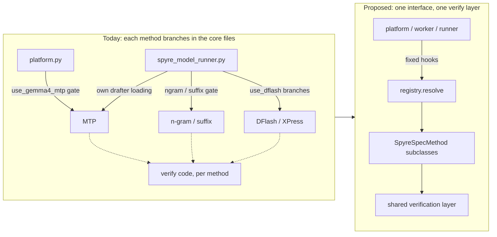
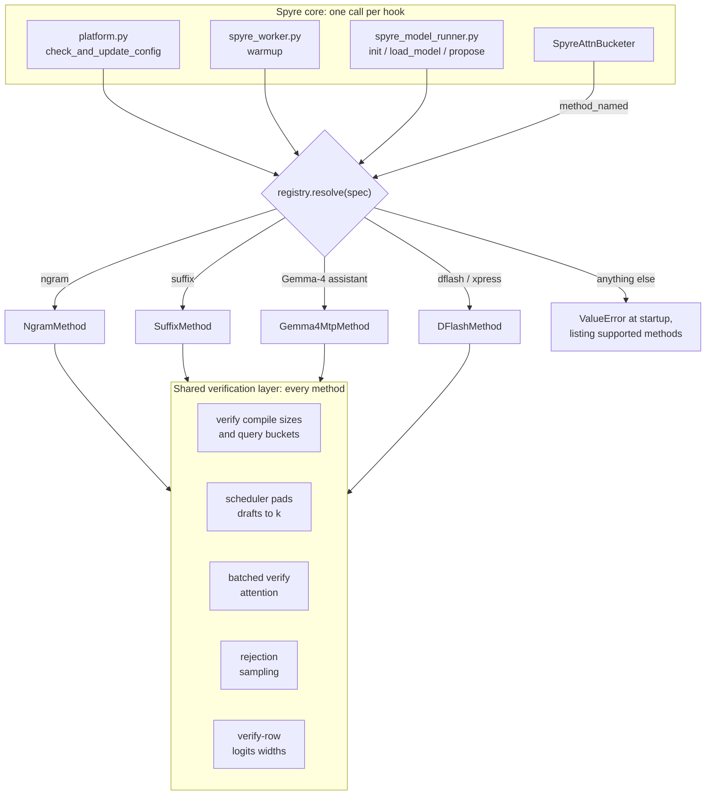
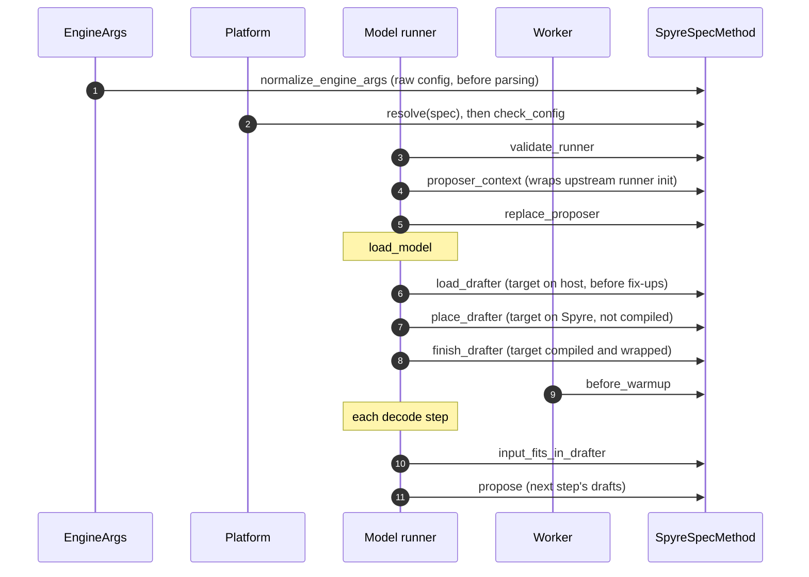
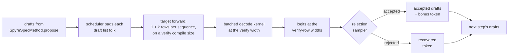

# RFC: One framework for speculative decoding on Spyre

| Field | Value |
|---|---|
| Status | Draft |
| Authors | Rehan Khan ([@R3hankhan123](https://github.com/R3hankhan123)), Rishika Kedia ([@rishikakedia](https://github.com/rishikakedia)) |
| Created | 2026-11-03 |
| Tracking | To be opened |
| Related | [#1440](https://github.com/torch-spyre/spyre-inference/pull/1440) (DFlash/XPress, merged), [#1446](https://github.com/torch-spyre/spyre-inference/pull/1446) (n-gram and suffix, open), Gemma-4 MTP (`mtp-spec-decoding`), [#1436](https://github.com/torch-spyre/spyre-inference/pull/1436) (host verification) |

## 1. Motivation

Three speculative-decoding integrations are landing at the same time, and each builds the shared
half of speculative decoding in its own way:

- **DFlash / XPress** (#1440, merged) adds `use_dflash()` branches throughout
  `TorchSpyreModelRunner`: the drafter gate, drafter loading, placement on Spyre,
  `_input_fits_in_drafter` and `propose_draft_token_ids`.
- **n-gram / suffix** (#1446) widens the drafter gate for model-free proposers and adds the
  verification machinery: verify compile sizes, scheduler draft padding, a multi-query batched
  decode kernel and rejection sampling.
- **Gemma-4 MTP** removes the drafter gate, adds drafter loading and its own verify compile sizes
  and attention path, and a platform check that accepts only a Gemma-4 MTP assistant — which, once
  rebased onto `main`, rejects DFlash.

The result is duplicate verification code, three drafter gates that disagree, and every new
method adding branches to `platform.py` and `spyre_model_runner.py`. Assumptions about what a
drafter looks like (whether it has KV layers of its own, at what width its attention runs) are
inferred in shared code rather than declared, and differ between methods.

This RFC proposes splitting speculative decoding into a **shared verification layer**, used
unchanged by every method, and a **per-method plug-in** that only says how drafts are proposed.



## 2. Goals and non-goals

### Goals

- One place that decides which speculative methods Spyre supports, and fails at startup otherwise.
- Method-specific code in the method's own module; the platform, worker and runner call fixed hooks.
- One implementation of each verification concern, shared by every method.
- No behaviour change for DFlash/XPress: its code moves behind the hooks at the same call points.
- Adding a method (EAGLE, a separate draft model) costs a subclass and a registry entry.

### Non-goals

- New speculative methods beyond the four already in flight.
- Per-batch-size `k` (`num_speculative_tokens_per_batch_size`); see §8.
- Lifting DFlash's current limits (single-request, without tensor parallelism).
- Model Runner V2; the hooks are V1-runner hooks.

## 3. Proposed architecture



### 3.1 The plug-in: `spec_decode/base.py`

```python
class SpyreSpecMethod:
    name: ClassVar[str]
    # Warmup records the drafter's own attention layers, with their causality.
    records_draft_attention: ClassVar[bool] = False
    # Query rows per request when the drafter attends through the target's builders.
    draft_query_len: ClassVar[int | None] = None

    @classmethod
    def matches(cls, spec: SpeculativeConfig) -> bool: ...
    @classmethod
    def normalize_engine_args(cls, engine_args) -> None: ...  # before vLLM parses the config
    def check_config(self, vllm_config) -> None: ...          # platform time
    def validate_runner(self, vllm_config) -> None: ...
    def proposer_context(self) -> AbstractContextManager: ... # wraps upstream runner __init__
    def replace_proposer(self, runner) -> None: ...
    def load_drafter(self, runner) -> None: ...    # target loaded on host, before fix-ups
    def place_drafter(self, runner) -> None: ...   # target on Spyre, not yet compiled
    def finish_drafter(self, runner) -> None: ...  # target compiled and wrapped
    def before_warmup(self, worker) -> None: ...
    def input_fits_in_drafter(self, runner, upstream, metadata) -> bool: ...
    def propose(self, runner, upstream, *args): ...
```

Every hook defaults to upstream's behaviour, which is all a model-free method needs. `upstream`
is passed as a callable and looked up only when a method defers to it. The three loading hooks
exist because the methods load at different points: DFlash loads against the uncompiled host
model and moves its drafter with the target; MTP loads after the target is compiled and wrapped,
and compiles the assistant per block like the target.

The two class attributes replace inference in shared code:

- `records_draft_attention` decides whether warmup asks the drafter for its KV layers and their
  causality. vLLM 0.32's `uses_draft_kv_cache()` is true for `mtp`, but the Gemma-4 assistant
  reads the target's KV cache and reports no draft KV layers.
- `draft_query_len` tells the attention bucketer which width the drafter's attention runs at
  through the target's builders, so warmup records the batched decode kernel there beside the
  verify width.

### 3.2 The registry: `spec_decode/registry.py`

```python
METHODS = (NgramMethod, SuffixMethod, Gemma4MtpMethod, DFlashMethod)

def resolve(spec: SpeculativeConfig | None) -> SpyreSpecMethod | None
def normalize_engine_args(engine_args) -> None
def method_named(name) -> type[SpyreSpecMethod] | None  # for code that has only the config
```

`resolve` raises `ValueError` naming the method and the supported list. The platform calls it in
`check_and_update_config`, so an unsupported configuration fails before any worker starts.

### 3.3 Call sites

| Where | Hook |
|---|---|
| `EngineArgs.create_model_config` wrapper | `registry.normalize_engine_args` |
| `TorchSpyrePlatform.check_and_update_config` | `resolve`, `check_config` |
| `TorchSpyreModelRunner.__init__` | `validate_runner`, `proposer_context`, `replace_proposer` |
| `TorchSpyreModelRunner.load_model` | `load_drafter`, `place_drafter`, `finish_drafter` |
| `TorchSpyreModelRunner._input_fits_in_drafter` | `input_fits_in_drafter` |
| `TorchSpyreModelRunner.propose_draft_token_ids` | `propose` |
| `TorchSpyreModelRunner._record_attention_graphs` | `records_draft_attention` |
| `SpyreAttnBucketer` | `draft_query_len` |
| `TorchSpyreWorker` warmup | `before_warmup` |

DFlash's `SPYRE_MODEL_RUNNER=v2` rejection stays inline in `check_and_update_config`, as on `main`.

The order the hooks run in, from engine start to a decode step:



### 3.4 Methods

| Method | Module | Overrides | Draft attention |
|---|---|---|---|
| n-gram | `ngram.py` | `before_warmup` (align numba's thread count with torch's, which Dynamo guards on) | none |
| suffix | `ngram.py` | none | none |
| Gemma-4 MTP | `gemma4_mtp.py`, `gemma4_proposer.py` | `check_config` (fp16 draft, context extended to the target's, async off), `replace_proposer`, `finish_drafter` | reads the target's KV; one row per request (`draft_query_len = 1`) |
| DFlash / XPress | `dflash.py` | `normalize_engine_args`, `validate_runner`, `proposer_context`, `load_drafter`, `place_drafter`, `input_fits_in_drafter`, `propose` | own KV layers (`records_draft_attention`) |

## 4. Shared verification layer

One verify step, through the layer every method shares:



One implementation of each, used by every method:

- **Compile sizes and query buckets.** A verify step packs `1 + k` tokens per running sequence;
  the default ladders add `n × (1 + k)` for each decode size `n` (from #1446).
- **Batched verify attention.** The scheduler pads every draft list to `k`, so each verification
  has one width, and the batched decode kernel serves it (from #1446). A method with a
  `draft_query_len` also gets the kernel recorded at that width, so its draft passes do not fall
  back to the per-sequence loop.
- **KV sizing.** `num_gpu_blocks_override` reserves `num_speculative_tokens` extra slots per
  sequence, which the scheduler holds for the next step's drafts.
- **Rejection sampling.** One path for every method, on the existing rejection sampler (#1436).
- **Draft-layer KV readers.** `attn_layer.install_kv_readers` and the runner's
  `maybe_add_kv_sharing_layers_to_kv_cache_groups` override handle any drafter whose layers read
  another layer's KV cache.

## 5. Behaviour changes

- An unsupported speculative method fails at platform startup with the supported list.
- KV sizing reserves `k` extra slots per sequence for every method.
- MTP warmup records one more batched-decode width, so it warms up longer.

## 6. Metrics

- **Structure:** no `use_dflash()`, `use_gemma4_mtp()` or method-name checks outside
  `spec_decode/` and the inline DFlash V2 check.
- **No regression:** DFlash/XPress hardware tests (`tests/e2e/test_speculative_decoding.py`) pass
  unchanged; n-gram and suffix acceptance lengths match #1446.
- **MTP under concurrent load** on the aiops trace, against the same run on the old branch: ITL
  and TTFT should fall with verification and draft passes on the batched kernel, with acceptance
  length unchanged.

## 7. Drawbacks

- **Indirection.** Following `load_model` means stepping into the method's hooks.
- **Hooks shaped by four methods.** A fifth may need a hook that does not exist yet.
- **Absorbs #1446.** This proposal carries #1446's verification work; it needs David's agreement
  and co-authorship, or #1446 lands first and this RFC rebases onto it.
- **Not yet validated on hardware.** See the validation plan (§9).

## 8. Alternatives

- **Keep per-method branches.** Smallest diff today; each new method adds branches to the
  platform and runner, and gates keep disagreeing, as MTP's did with DFlash.
- **Land the three PRs separately, refactor later.** Each would duplicate verification code that
  the later refactor removes, and the MTP platform check breaks DFlash in between.
- **Upstream vLLM's proposer classes as the interface.** They cover proposing, not Spyre's
  concerns (compile, warmup widths, placement on the card, platform checks), so Spyre still needs
  its own hooks.
- **Per-batch-size `k`.** vLLM 0.32 supports a `(min_batch, max_batch, k)` schedule. The shared
  layer assumes one verify width; supporting a schedule means one compile and attention width per
  `k`. Left for a follow-up once a single width is measured.

## 9. Implementation plan and validation

One PR:

1. `spec_decode/base.py` and `registry.py`; DFlash moved behind `DFlashMethod`.
2. #1446's shared verification layer, as `NgramMethod` and `SuffixMethod`.
3. Gemma-4 MTP as `Gemma4MtpMethod`, without its duplicate compile sizes, attention path and
   platform check.

Validation: the CPU suites under `tests/spec_decode` and the attention, bucketer, scheduler and
platform tests; `ty check`; then the hardware checks in §6.

## 10. Open questions

1. One PR, or #1446 first with this rebased on top?
2. Should the shared layer allow a set of verify widths now, to leave room for per-batch-size `k`?
3. Do DFlash's limits stay in `DFlashMethod.validate_runner`, or lift once batched verification
   is proven?
