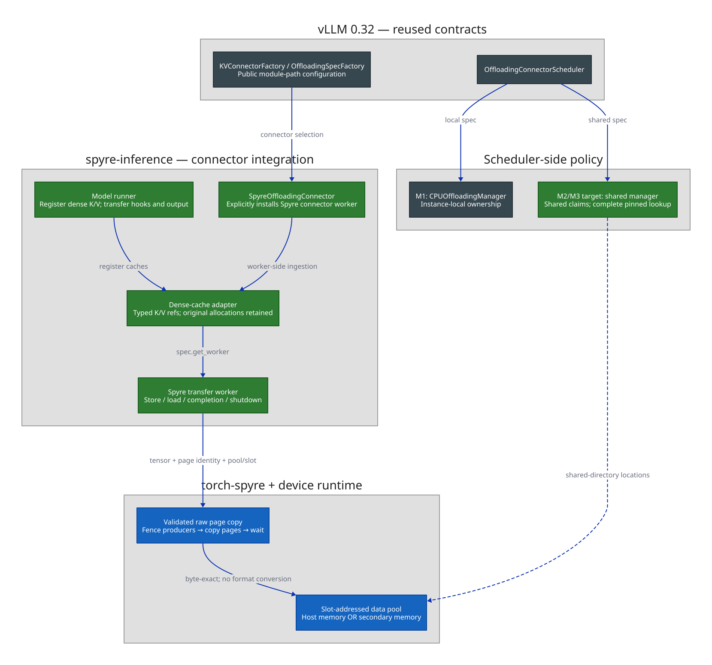
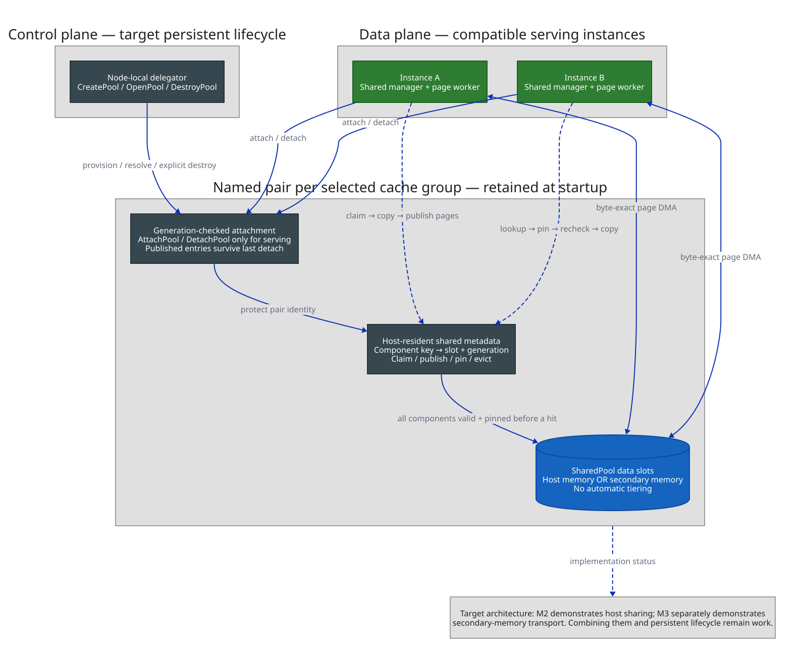

# RFC: Port the upstream KV Connector experience to spyre-inference

| Field | Value |
|---|---|
| Status | Draft |
| Authors | Chen Wang ([@wangchen615](https://github.com/wangchen615)), Yue Zhu ([@yuezhu1](https://github.com/yuezhu1)), Pravein Govindan Kannan ([@praveingk](https://github.com/praveingk)), Hubertus Franke ([@frankeh](https://github.com/frankeh)) |
| Created | 2026-06-05 |
| Updated | 2026-10-28 |
| Tracking | First design doc for [#76 — \[Epic\] Develop KVCacheConnector for Spyre](https://github.com/torch-spyre/spyre-inference/issues/76) |
| Related | vLLM `OffloadingConnector`; device-runtime shared-pool and persistent-lifecycle designs; M1/M2/M3 offload prototypes |

## 1. Motivation

vLLM's `OffloadingConnector` separates scheduler-side cache policy from worker-side transfers.
Spyre can reuse this framework without upstream patches, but needs its own dense-cache ingestion
and byte-exact transfer path. The stock CPU-offload worker is implemented for CUDA-alike/XPU devices.

This RFC describes three incremental capabilities:

1. **M1 — instance-local host-memory offload:** reuse an offloaded prefix across requests in one engine.
2. **M2 — shared host-memory offload:** another compatible instance on the same node can find and load
   that prefix through a shared allocator and directory.
3. **M3 — secondary-memory offload:** use a secondary-memory data pool behind the same shared-pool
   contract, retaining CPU-resident metadata.

Working development branches exist for these three stages (§9). They establish the implementation
path, not availability in the main-branch dependency pins or completion of the persistent-lifecycle
contract. This remains an agreed starting design, with implementation and production hardening in
follow-up PRs.

Host DRAM and secondary memory are **alternative, co-equal pool backends**. This RFC does not define
an automatic hierarchy, spill to DRAM, promotion/demotion, or lookup across unrelated pools. It makes
no relative performance claim about the memory kinds.

## 2. Goals and non-goals

### M1 — instance-local host memory

- Select `SpyreOffloadingConnector` and `SpyreOffloadingSpec` through existing vLLM configuration.
- Reuse upstream `CPUOffloadingManager` for local admission, eviction and block bookkeeping.
- Offload and restore the device representation byte-for-byte, without converting through host floats.
- Support dense head-major and token-major model-dtype caches; validate each layout's physical page
  mapping separately. FP8 acceptance is a separate gate (§6.1, §12), not implied by FP16 success.
- Preserve the no-connector serving path and avoid an upstream vLLM patch.

### M2 — shared host memory

- Let compatible instances attach the same named data/metadata pair and discover published prefixes.
- Use a shared allocator and generation-checked directory, not independent local allocators pointing
  at the same backing.
- Never consume a reserved, stale, incompatible or partially written entry as a cache hit.
- Separate pool administration from serving: a node-local control-plane service (the **delegator**)
  manages pool creation/discovery/destruction; serving processes attach/detach only.
- Keep the pool and published entries across a zero-attachment interval, normal shutdown or a serving
  process restart. Host shared memory is not durable across node reboot.

### M3 — secondary memory

- Replace the data-pool backend without replacing vLLM's scheduling contract or the shared directory.
- Keep transport, backing acquisition and device-visible addresses below the Python boundary.
- Apply the same compatibility, completion, publication and persistent-lifecycle rules as M2.

Cross-host PD disaggregation, filesystem/object-store integration, cross-topology raw-page reuse,
and automatic multi-tier placement are separate work (§11).

## 3. Background: the pinned upstream contracts

**Version basis.** Source references below were checked against spyre-inference main
`94f4f6950f7e979a7cac5808bf85f283f09ea530`. Its `pyproject.toml` specifies
`vllm[grpc]>=0.32.0,<0.33`; `uv.lock` resolves tag `v0.32.0` to
`5df63a7203cdb9328d824a27b682e77c7b9928be`. The torch-spyre pin is
`64870622fc39cda7e344a271decb901e7088c6c6`. These are source checks, not hardware qualification
of that dependency combination.

### 3.1 Dense KV caches and the ingestion point

`SpyrePagedKVCache` is a named tuple with **two dense tensors**, `key` and `value`, per layer.
It is not two Python lists of separately allocated pages. Each tensor's leading dimension is
`num_blocks`, and its remaining dimensions come from the selected attention backend:

| Backend | Shape of each K or V tensor | Selection |
|---|---|---|
| `SpyreHeadMajorAttentionBackend` | `[num_blocks, num_kv_heads, block_size, head_size]` | Default |
| `SpyreAttentionBackend` | `[num_blocks, block_size, num_kv_heads, head_size]` | `SPYRE_ATTN_KV_LAYOUT=token_major` |

`allocate_spyre_kv_caches` in `spyre_inference/v1/worker/kv_cache_setup.py` delegates to each
attention implementation's `allocate_pages`. It uses `kv_cache_config.num_blocks` directly and
preserves aliases for shared layers. There is **no rounding of the block count to a multiple of 64**
in this allocator. Physical tensor padding and head-dimension constraints are separate issues.

At vLLM 0.32, `OffloadingConnector` delegates worker calls to `OffloadingConnectorWorker` in
`vllm/distributed/kv_transfer/kv_connector/v1/offloading/worker.py`. Its `register_kv_caches`:

1. Selects offloaded groups and derives canonical mappings.
2. Calls `group_kernel_blocks` for each layer's tensor.
3. Builds an `int8` storage view using `set_(ref.untyped_storage(), byte_offset, size, stride)`.
4. Deduplicates aliased regions and calls `_init_worker(canonical_kv_caches)`.

The former `isinstance(layer_kv_cache, torch.Tensor)` assertion is **not** the current failure
premise. The dense K and V fields are tensors; the outer pair still needs adapting to upstream's
single-tensor-per-layer contract. More importantly, a logical byte-strided storage view is not a
validated description of a padded/tiled device page. Canonicalization precedes `spec.get_worker`,
so changing the spec alone cannot fix ingestion. §6.6 retains a small dense-cache adapter for this
reason, not a paged-list adapter.

### 3.2 `OffloadingSpec`, `OffloadingWorker` and canonical caches

`vllm/v1/kv_offload/base.py` defines:

- `OffloadingSpec(config: OffloadingConfig)`, with `get_manager()` and `get_worker(kv_caches)`.
- `OffloadingWorker`, with `submit_store`, `submit_load`, `get_finished`, `wait`, and optional
  `shutdown`. `TransferResult` records job completion and success.
- `GPULoadStoreSpec`, containing device block IDs, group sizes and logical block indices. Its name
  does not require CUDA. Group/chunk mapping must be respected; blindly zipping host and device
  block-ID lists is insufficient when `blocks_per_chunk > 1`.
- `CanonicalKVCacheTensor(tensor, page_size_bytes)` and per-group `CanonicalKVCacheRef` entries,
  including optional `mapping: CanonicalPageMapping | None`.

The tensor contract permits a leading block dimension `(num_blocks, ...)`; the stock worker turns
it into a byte view. Our worker consumes the original typed dense tensors instead. Reusing these
containers does not certify that raw pages are portable across TP layouts: leave `mapping=None`
unless that mapping has actually been established, and reject unsupported canonical/replicated
layout modes.

`OffloadKey` includes the KV-cache group index as well as the block hash. Shared lookup must retain
that group identity and the request context required by the current manager API.

### 3.3 CPU reference implementation

`CPUOffloadingSpec.get_worker` in `vllm/v1/kv_offload/cpu/spec.py` rejects platforms other than
CUDA-alike/XPU before calling `create_worker`. `CPUOffloadingWorker` in `cpu/gpu_worker.py` uses
byte views and accelerator streams/events. Neither is a ready-made Spyre transfer implementation.

We subclass `OffloadingSpec` directly rather than inheriting and replacing CPU-specific behavior.
This is a factoring choice, not a claim that Python subclasses cannot override `get_worker`.
`CPUOffloadingManager` itself is platform-independent and reusable for **M1**. It takes
`num_chunks`, cache-policy options, event settings and admission thresholds. The Spyre spec must
also declare the metric definitions its manager emits through `build_metric_definitions`.

M2 cannot inherit that manager unchanged: a per-instance dictionary/allocator neither discovers
peer entries nor reserves shared slots safely (§6.8).

### 3.4 Public configuration seams

- `kv_connector_module_path` lets `KVConnectorFactory` load the Spyre connector.
- `spec_name` and `spec_module_path` in `kv_connector_extra_config` let `OffloadingSpecFactory`
  load the Spyre spec. Registry calls are optional conveniences, not prerequisites.
- A secondary tier's `module_path` is a different setting; it does not select an offloading spec.

No upstream patch is required for these seams. They do not eliminate the plugin's responsibility
to wire cache registration, transfer hooks, worker output and shutdown into its model runner.

### 3.5 Filesystem/object tiering is background, not a free integration

Upstream `TieringOffloadingSpec` subclasses `CPUOffloadingSpec`. Its primary tier exposes a host
`memoryview` to filesystem/object secondary tiers. Selecting it does not compose our Spyre spec
underneath it, and a pool addressed only by slots is not that host-memory interface.

Consequently, adding `tiering/fs` or `tiering/obj` is **not a config-only extension of M1**. It needs
separate primary-tier/worker integration. Likewise, an unrelated LMCache or NIXL connector does not
automatically gain Spyre support merely because this connector exists.

### 3.6 What changed since the earlier version basis

| Earlier assumption | Verified v0.32 contract / design consequence |
|---|---|
| Connector worker will move into `offloading_connector.py` | At this exact tag it is imported from `offloading/worker.py`; use the pinned source, not a predicted move. |
| Constructor shape is uncertain | `OffloadingConnectorWorker(spec, vllm_config, kv_cache_config)`; test this integration on each bump. |
| A connector `_worker_cls` attribute selects the subclass | Upstream directly constructs `OffloadingConnectorWorker`; no such factory hook exists at this pin. |
| Canonical caches require a paged-list bridge | Dense K/V tensors need a small typed adapter and physical page-copy contract. |
| Storage reinterpretation is wholly unsupported | The pin registers `set_.source_Storage_storage_offset`; that is not proof of valid raw device-page addressing (§4). |
| Shared CPU backing and mappings are future drift | `_uses_shared_region()`, `CanonicalPageMapping`, and `OffloadingConfig` already exist; do not advertise unimplemented Spyre replicated/canonical layouts. |

## 4. Device-copy contract and current torch-spyre

The pinned torch-spyre exposes converting `copy_tensor`. A converting device→host→device transfer
is not a contract for preserving the device representation, even if ordinary floating-point tests
pass. KV offload must snapshot and restore **raw bytes**, with no quantization, dequantization or
layout conversion in the transport.

A source check of the pin found no `copy_tensor_raw` or shared-pool bindings. The working prototypes
use local dependency builds with additional APIs (§9). They must not be described as available
merely by installing the main-branch lockfile.

**Storage recheck.** `torch_spyre/csrc/spyre_mem.cpp` registers
`set_.source_Storage_storage_offset`; `spyre_set_storage` delegates to `at::cpu::set_`.
Spyre-aware view implementations in `spyre_views.cpp` explicitly carry tensor layout and DMA
size/stride metadata. The old blanket statement that `.set_()` is unsupported is therefore removed.
However, a generic `int8` storage reinterpretation does not establish the correct physical page
layout or preserve all that tensor metadata. No device round-trip through upstream canonicalization
was run for this docs-only revision; the adapter remains until that complete path is qualified.

### 4.1 Runtime/binding boundary

The proposed shared-pool interface is:

```python
copy_tensor_raw(dev_tensor, pool, slot_id, to_device, non_blocking=False)
```

`to_device=False` stores into a slot; `True` restores from it. The tensor and pool/slot are the Python
boundary. The device runtime owns address resolution support, physical byte movement, bounds checks
and backing retention; torch-spyre provides the tensor-aware bindings. Python receives no raw host
pointer, device address or host-buffer-registration API.

`SharedPool` provides immutable slot geometry and checked copy dispatch. Concrete host-memory and
secondary-memory pools own their local mappings or provider resources. The host backend manages
shared-memory mapping and pinning per device function; the secondary-memory backend retains its
provider range. Backing must stay valid until DMA completes, regardless of Python handle lifetime.

**Dense-page prerequisite.** The baseline pooled call copies a complete allocation. A slice such as
`cache.key[block_id]` is a view into a larger allocation, not necessarily an independently transferable
page. The production binding must support a validated page/range transfer, or another explicitly
byte-exact page operation, before it can offload dense caches. It must not silently snapshot the
whole layer into a page-sized slot. The prototypes' page-copy implementation is evidence for this
extension, not evidence that the baseline whole-allocation signature already handles views.

Single-chunk raw transfers are the baseline. Multi-chunk packing/restoration is a runtime extension,
with ordered chunk sizes/domain identities and no persisted process-local addresses. Unsupported
chunking or layouts must fail explicitly; same logical shape/dtype alone does not prove compatibility.

## 5. Proposed architecture



Diagram sources: [D2](figures/spyre-offloading-arch.d2),
[Mermaid](figures/spyre-offloading-arch.mmd).

The plugin owns vLLM integration, selection/admission policy, compatible cache identity and transfer
sequencing. torch-spyre and the device runtime own byte-copy and shared-memory mechanisms. The
control plane owns persistent pool lifecycle, not the serving worker.

### 5.1 Worker factoring

`SpyreOffloadingWorker` implements the current upstream worker ABC. A copier isolates device-specific
operations from scheduler bookkeeping and enables mock tests. Per-direction helper objects are
optional implementation details, not upstream extension points or a requirement to duplicate state.

The initial correctness path waits for copies before exposing completion. Batching submissions and
waiting once per job is compatible with this contract. Neither a `non_blocking` flag nor queue
submission alone means that bytes are safe to consume or publish.

### 5.2 Manager factoring

M1 reuses `CPUOffloadingManager`. M2/M3 provide a shared manager implementing `OffloadingManager`
over the runtime directory/allocator. They can reuse admission/eviction policy choices, but **not**
an independent instance-local ownership map as the authority for shared slots.

The shared manager handles lookup, reservation, load protection, publication, completion and local
request cleanup. Changing only pool construction in the M1 spec is not enough to implement sharing.

## 6. Component design

### 6.1 `SpyreKvDmaCopier`: layout and physical capacity

The copier takes dense K/V tensors plus page identities and validated pool destinations. It must
preserve the selected backend layout; head-major and token-major pages are not interchangeable even
when their logical byte counts match. No per-transfer host transpose or float conversion is allowed.

Capacity is based on **physical transfer extents**, not blindly on
`numel() * element_size()`, and not on the size of the entire dense layer divided by block count
without a validated layout mapping. Use the runtime's size/alignment information for the actual
page/range operation. The aligned slot stride must accommodate every physical fragment assigned to
it; all range/stride/slot arithmetic is bounds- and overflow-checked.

A vLLM offloaded chunk may cover multiple device blocks and all K/V tensors in a cache group. In
the M2 prototype, **each component page has its own directory entry and slot**, keyed by the full
`OffloadKey` plus component identity. A stable manifest fixes layer order, K/V order, page order and
rank-local ownership. Slots need not be adjacent. Publication is per page, not an atomic transaction
over the whole chunk: a logical hit requires every component to be valid and successfully pinned.
Capacity negotiation between scheduler and workers must agree on complete chunks, not confuse a
K-only page slot with one vLLM chunk. Heterogeneous layers need validated per-tensor extents, not one
guessed page size. The initial PoCs require `blocks_per_chunk == 1` and one KV group; supporting
larger chunks or multiple groups is an explicit extension, not demonstrated behavior.

**Layout/dtype coverage:**

| Cache layout and encoding | Current attention support | Offload requirement |
|---|---|---|
| Head-major, model dtype | Default; normally FP16 | Qualify dense page addressing, padding and raw round-trip. |
| Token-major, model dtype | Explicit opt-in | Qualify its distinct page mapping; do not use head-major offsets. |
| Head-major, `fp8` / `fp8_e4m3` | Allocated as `torch.float8_e4m3fn`; requires `head_size % 128 == 0` | Separate raw-copy/slot-sizing and end-to-end acceptance gate. |
| Token-major, FP8 | Rejected by current attention implementation | Reject during configuration; do not imply M1 enables it. |

For FP8, the vLLM cache spec can report `uint8` while actual device pages hold E4M3 values. Store the
existing encoded bytes, not an FP16 expansion or a new quantization. Physical padding/alignment
still applies: a logical one-byte dtype does not guarantee a pool slot is exactly half its FP16
size. Compatibility includes the encoding, layout, quantization scheme and resolved per-layer K/V
scales. Current attention uses per-layer scales rather than putting scales into each cache page;
shared reuse must establish identical scales or explicitly carry/restore them as part of a future
format. Raw bytes copied under different scales are not reusable KV.

Until the production page-copy API supports and passes a layout/dtype combination, reject that
combination explicitly. Attention support by itself is not offload qualification.

### 6.2 Transfer ordering and worker completion

For each store job:

1. Retain the source pages and destination reservation.
2. Fence all relevant pending compute/KV writes before raw DMA reads the pages. Synchronizing only
   after copying cannot repair a snapshot taken before the producer finished.
3. Transfer all K/V pages for the selected groups/chunks and wait for completion.
4. Publish each newly stored shared page only after its DMA completes. Report job success after its
   required transfers finish; complete pinned lookup across components/ranks establishes logical
   availability. The runtime does not supply an atomic multi-worker publication barrier.

For a load, retain the source slot protection through the final DMA completion and make restored
pages visible before attention runs. Block reuse, preemption, cancellation, `wait` and `shutdown`
must respect in-flight transfers. Failed stores must not publish; failed loads must not be consumed
as restored KV. After a scheduled hit fails, return the upstream failure/recompute path rather than
silently treating partially loaded device pages as usable.

### 6.3 `SpyreOffloadingSpec`

Subclass `OffloadingSpec` directly. `get_manager` creates the M1 `CPUOffloadingManager` with validated
chunk capacity and the current cache-policy/event options. `get_worker` builds the Spyre transfer
worker from canonical dense tensors. Declare matching metric definitions instead of inheriting the
base class's empty definition set while emitting CPU-manager statistics.

Pool/DMA construction belongs on the worker side after cache geometry is known; constructing a spec
in the scheduler must not initialize an accelerator stream. Keep imports lazy so installations
without the optional lower-layer APIs can still use spyre-inference with no offload connector.

The shared spec replaces both the local manager and pool-resolution behavior. Reuse the byte mover
and validated page mapping where possible, not a promise of identical worker/spec source in every
milestone.

### 6.4 Secondary-memory backend

M3 uses the same slot-copy and directory contracts with a secondary-memory data pool. Metadata
remains host-resident and CPU-accessible. The runtime owns acquisition, attachment and retention of
the provider backing; the plugin does not construct provider handles or device-visible addresses.

A pool is a DMA endpoint, not necessarily a host-mappable byte array. Multiple named pools can
coexist; a cache group attaches its selected pair at startup. This does not imply one global pool,
a host-wide directory spanning all pools, per-hit pool resolution, or fallback into another backend.
Unsupported backends fail clearly instead of silently switching to host memory.

### 6.5 Registration and serving configuration

M1 uses the existing configuration seams:

```bash
vllm serve "$MODEL" --kv-transfer-config '{
  "kv_connector": "SpyreOffloadingConnector",
  "kv_connector_module_path": "spyre_inference.v1.kv_offload.connector",
  "kv_role": "kv_both",
  "kv_connector_extra_config": {
    "spec_name": "SpyreOffloadingSpec",
    "spec_module_path": "spyre_inference.v1.kv_offload.spec",
    "cpu_bytes_to_use": 8000000000
  }
}'
```

This is an implementation target; the main-branch dependency pin does not supply the raw-pool APIs.
A PoC build must use its matching dependencies and configuration, not the lockfile alone.

For persistent shared pools, the **proposed** public selection is
`kv_connector_extra_config.pool_name`, with `SPYRE_KV_POOL_NAME` as fallback. Resolve it once before
worker processes start:

1. An explicitly present `pool_name` wins. Empty/invalid values are errors, not a fallback request.
2. Otherwise use the environment value, if present and valid.
3. Otherwise generate an instance-specific name to prevent accidental sharing.

Use logical names matching `[A-Za-z0-9][A-Za-z0-9._-]*`; validate length including derived suffixes
and never truncate. Log the effective name and source, then propagate the resolved configuration.
Workers and bindings must not independently reread the environment.

Derive deterministic rank/shard/cache-group suffixes, for example `_r0_c0`, from agreed topology.
Explicit shared names must not acquire a process-local engine ID; generated defaults must retain
instance identity. Derive matching data, metadata and lifecycle names from the same scope. Naming
alone does not implement sharing: the shared allocator and compatibility checks remain mandatory.

The delegator resolves the name to a descriptor whose backend, slot geometry, compatibility and
pool generation were fixed at creation. Neither `cpu_bytes_to_use` nor worker-local defaults may
resize an existing shared pool. Exact Python lifecycle binding/config field names remain subject to
the lower-layer implementation; do not document prototype-only backend selectors as a stable API.

### 6.6 `SpyreOffloadingConnector`: dense-cache ingestion

The adapter should retain each original typed dense K and V tensor, create one
`CanonicalKVCacheTensor` per unique field, and build ordered per-group references. Preserve known
shared-layer aliases without manufacturing a device byte view. Validate the selected groups,
per-layer specs, block counts, layout and supported dtype before initializing the transfer worker.
Physical transfer sizes come from the page-copy contract (§6.1), not storage reinterpretation.

This is a **dense adapter**, conventionally `spyre_dense_to_canonical`, replacing the earlier
`spyre_paged_to_canonical` sketch. There is no concatenation of per-block Python lists and no reason
to allocate a second canonical device cache.

At the pin, upstream's connector constructor directly instantiates its worker; assigning a
`_worker_cls` attribute has no effect. The plugin connector must explicitly install its
`SpyreOffloadingConnectorWorker` on the worker role, preserving the upstream scheduler role and
configuration. Its registration override then calls inherited `_init_worker` with our canonical
containers. Test that the intended worker is actually constructed, not merely that the subclass
exists.

The model runner also needs connector lifecycle integration: register caches after
`allocate_spyre_kv_caches`, run load/save and preemption hooks around execution, propagate connector
output, and drain/shut down transfers. The PoC includes this wiring. The old acceptance criterion
that **no worker/model-runner file may change** is withdrawn. The allocator's backend-owned layout
need not change, but connector wiring cannot be omitted.

### 6.7 Shared-pool lifecycle: control plane versus data plane

The persistent-lifecycle contract supersedes prototype `create_or_attach` and last-detacher-unlink
behavior for named shared pools.

| Owner | Responsibilities |
|---|---|
| Node-local delegator | `CreatePool`, `OpenPool`, `DestroyPool`; provisioning, discovery, recovery and explicit retirement policy. Not in the KV-copy path. |
| Serving processes | Resolve through the delegator; `AttachPool` / `DetachPool`; perform ordinary cache lookup, reservation, copy and eviction. Never create or destroy a persistent pool. |
| torch-spyre | Thin tensor-aware bindings and local handle lifetime; no separate pool policy. |
| Device runtime | Geometry validation, backing attachment, DMA retention, metadata synchronization and generation-checked lifecycle mechanism. |

`PoolConfig` identifies logical name, memory backend, immutable slot geometry and versioned KV
compatibility. A descriptor includes the opaque **pool generation**, state and effective config.
Attach requires `READY`, matching generation/config and the original data/metadata backing. Missing,
replaced or incompatible backing is unavailable; do not create a replacement during lookup/attach.

Attachments hold a shared lifecycle `flock` until dependent metadata/data mappings and DMA resources
are released. Destruction requires exclusive access and the expected pool generation; busy pools
return `PoolBusy` without leaving `READY`. There is no force-destroy by a serving worker and no
authoritative process-count field whose decrement destroys the pool.

The runtime serializes management with a persistent per-name guard, publishes a fully initialized
root atomically, and can recover interrupted `INITIALIZING`/`DESTROYING` transitions. Recovery must
not remove a `READY` pool. Same-name recreation gets a new generation, invalidating old descriptors.

Last detach, `shutdown` and `reset_cache()` release local work/pins/bookkeeping, **not published
shared entries**. Normal cache eviction remains permitted under the slot protocol. Existing
attachments can keep serving if the delegator is unavailable; new resolution retries or fails,
never silently creates a local replacement. Persistence across zero attached processes is not
persistence across host reboot.

### 6.8 Shared manager, identity and concurrency



Diagram sources: [D2](figures/spyre-shared-pool-m2.d2),
[Mermaid](figures/spyre-shared-pool-m2.mmd).

Each selected cache group has a matching named data-pool/metadata pair, retained for the session.
The metadata is pageable host shared memory for either backend. Its directory maps each compatible
component-page key to a slot and **slot generation**; the serving-side manager composes and validates
the complete chunk manifest. Pool generation protects backing incarnation; slot generation protects
reuse within a live pool. Neither replaces the other.

**Compatibility.** A shared prefix requires matching model/revision and relevant adapters, hash
algorithm/seed and request identity inputs, cache-group/layer order, block/chunk geometry, attention
layout, dtype/encoding and scales, TP rank/shard topology, and versioned physical format. Equal
names, hashes or byte counts alone are insufficient. Reject incompatible attachments before DMA;
do not claim cross-TP raw-page portability.

**Store.** Claim missing component pages under the shared allocator/directory lock, with duplicate
recheck and first-writer-wins semantics; already valid pages can be reused. Entries transition
`EMPTY → RESERVED → VALID`; a reservation is neither readable nor evictable. Release the directory
lock before DMA. Complete all new page copies before publishing them individually. Logical readiness
comes from complete pinned lookup, not an assumed multi-entry atomic publish. After failure, quiesce
DMA before aborting reservations or removing only attempt-owned publications, rechecking tenancy.
A future multi-worker extension must not report a logical hit while any required rank is missing.

**Load.** Obtain a safe lookup snapshot, acquire the process-shared per-slot read protection, and
recheck generation plus `VALID` **before** copying. A stale snapshot is a miss with no DMA. Hold
protection through completion. For a chunk spanning slots, protect the entire required manifest
before consuming it; an incomplete manifest is not a partial hit.

**Eviction.** Obtain exclusive slot protection, then the directory lock; recheck tenancy, remove the
mapping and advance the slot generation before reuse. Never wait for a slot lock or DMA while
holding the directory lock. Refuse generation exhaustion rather than wrap.

The baseline slot protocol uses process-shared pthread read/write locks. Unlock on the same OS
thread that acquired the lock; do not rely on arbitrary Python finalization or a completion callback
on another thread. Bindings release the GIL during blocking attachment/locking/copy/wait operations.
The GIL is not cross-process synchronization, and no directory lock spans the whole
claim→copy→publish sequence.

**Crash boundary.** Lifecycle `flock` cleanup on process exit does not make pthread slot locks robust
or prove device DMA has stopped. A timeout, dead PID or recovered directory mutex alone does not
justify resetting locks or recycling active storage. If quiescence cannot be established, mark the
affected pool unavailable pending coordinated recovery. The design must not promise that every
mid-copy failure can be downgraded to an ordinary miss after bytes were already consumed.

## 7. Implementation plan

Keep the plugin-specific code in `spyre_inference/v1/kv_offload/`; the prototype may factor modules
differently as the interfaces settle. Avoid estimated line counts as an architectural constraint.

| Stage | Plugin work | Lower-layer prerequisites |
|---|---|---|
| M1 | Dense canonicalization, connector/runner lifecycle, local spec/manager, byte copier, transfer completion and metrics | Raw dense-page/range copy, physical extent validation, compute-to-DMA ordering, host pool |
| M2 | Shared manager and transfer specs, compatible keys, reservations/publication/pins, shared configuration | Matching named host data/metadata pair, shared allocator and concurrency mechanism |
| M3 | Backend selection using the same shared contracts; secondary-memory integration tests | Secondary-memory pool implementation, provider attachment and validated page transport |
| Persistent shared-pool hardening | Delegator resolution, attach/detach-only serving, local reset semantics, restart/recovery tests | Generation-checked lifecycle, whole-pool attachment protection, recoverable creation/destruction |

Persistent lifecycle applies to **both** M2 and M3; it is not an optional implementation detail of
one memory backend. Existing instance-local M1 scratch pools may remain ephemeral, provided they
cannot accidentally attach or destroy a persistent shared pool.

Change the dependency pin only in implementation PRs that have matching runtime builds and hardware
qualification. This RFC adds no runtime code or dependency override.

## 8. Compatibility with other connectors

M1 supplies a device↔host offload path through **our** connector. M2/M3 add on-node shared reuse.
Neither registration makes stock `OffloadingConnector` understand a Spyre K/V pair, nor does it add
our raw-copy path to all other connectors.

Filesystem/object tiers need explicit integration with a suitable primary tier (§3.5). LMCache and
NIXL integrations require their own storage/transfer/lifecycle checks. PD disaggregation additionally
requires transport, routing, request handoff and failure semantics. These are follow-ups, not
features automatically unlocked by a config change.

## 9. Alignment with the working prototypes

The fork's three branches demonstrate separate capabilities; they are **not a cumulatively integrated
M1→M2→M3 product**. In particular, M3 selects a secondary-memory backend for the M1-style worker and
does not contain M2's shared manager/spec/worker. Combining sharing with secondary memory remains
integration work.

| Branch / inspected tip | Implemented shape | Boundary still to close |
|---|---|---|
| `kvc-offload-m1` / `582390cc1472328b41330d6c21f01b66c08a1a08` | Dense host-page offload, upstream local manager, connector/runner wiring; per-cache pools with K slot `2*h` and V slot `2*h+1` | Physical capacity negotiation; full failure-path quiescence; production dependency/API integration |
| `kvc-offload-m2` / `28bf1a2768e9758071ebfa1c06a11041551a4042` | One shared host data pool across components, directory, shared manager/worker, fragmented page slots and complete pinned lookup | TP1, one group, one block per chunk, FP16, single-chunk allocations and `uni` executor only; persistent lifecycle remains separate |
| `kvc-offload-m3` / `7921f92110133631c37e022a40719e6e6b908f89` | Selectable host or secondary-memory transport behind the M1-style page offloader; disjoint per-rank/per-cache backing windows | No M2 directory integration or global backing allocator; independent engines still need non-overlapping assigned regions |

**Concrete transfer seam.** `SpyreKvPageOffloader` in
`spyre_inference/v1/worker/spyre_kv_offload.py` calls
`copy_kv_page_raw(tensor, block_id, pool, slot_id, to_device, non_blocking)`. It passes the original
rank-four allocation plus the block ID, letting the native binding identify the physical page range;
it does not copy the whole layer just because the argument is the full tensor. The page starts at
byte zero of its destination slot. Its size helper divides physical allocation size by block count
with a divisibility check; production support must validate that mapping for every admitted layout.

The PoC helper is still named `spyre_paged_to_canonical` in `kv_offload/connector.py`, but it handles
dense tensors: flattened K/V views serve bookkeeping, while `SpyrePhysicalCaches` retains the
original allocations for DMA. §6.6's dense name describes the intended factoring, not a claim that
the branch already renamed it. There is no dtype-changing canonical copy.

**Shared mechanism.** M2's `shared_spec.py`, `shared_manager.py`, `shared_worker.py` and
`shared_types.py` implement the shared spec, manager, worker and component manifest. Slot stride is
the aligned largest component-page size; logical capacity is
`floor(budget / (component_count * slot_stride))`. All components must be found and pinned for a hit;
partial publication alone cannot create one. Local upstream admission policy is reused, while shared
claims/pins determine actual slot ownership. Peer-owned pages are readable, but this is not a global
victim policy or orphan-page scavenger.

M2 currently registers one data pool with its directory and carries versioned pool/slot references.
The target runtime design instead attaches a matching named pair at startup (§6.4, §6.8); a global
registry or per-hit pool resolution is not a requirement carried forward from that prototype.
Its configured model/revision digest also must not be mistaken for verification of actual weights or
all semantic settings. The full compatibility contract in §6.8 remains the requirement.

**Ordering.** All three inspected tips fence the device on job entry, enqueue page copies with
`non_blocking=True`, then synchronize once before reporting success. Job submission remains
synchronous; this is not serving/transfer overlap or a native batched-descriptor API. M2 additionally
quiesces and rolls back attempt-owned pages on failure; the other branches do not establish the same
transactional failure recovery.

**Evidence and remaining gates.** `tests/kv_offload/` contains both-layout FP16 page/worker tests,
M2 shared-manager and shared-worker tests, and an opt-in two-server cross-instance test. M3's secondary
backend tests require explicit hardware setup and otherwise skip. The M2 branch's recorded manual
run in `docs/superpowers/results/2026-09-30-spyre-shared-kv-manual-demo.md` reports a compiled one-pool
A→A→B reuse demonstration; it is evidence from an earlier development state, not a rerun of these tips.
No hardware tests were rerun for this RFC revision, and the offload suites do not establish FP8 reuse.

Prototype creation/last-handle cleanup and operator demo cleanup are **not** persistent control-plane
management. Their local dependency pins and backend-specific selectors are not a stable public API.
Persistent attach/detach-only serving, zero-attachment reuse, crash recovery and M2+M3 integration
require the newer lifecycle and shared-backend work. §12 keeps those gates separate.

## 10. Open questions and resolved review points

1. **Dense page-copy API and physical accounting.** Settle the production tensor/page or range
   interface, supported layouts, authoritative byte extents and scheduler/worker capacity agreement.
   The whole-allocation pool call cannot simply be applied to a dense-page view.
2. **Canonicalization — corrected premise.** Dense K/V fields replace the old paged-list assumption.
   Retain the small adapter until upstream ingestion and its storage view are fully qualified on
   Spyre. The exact pin implements a storage-offset `set_` overload; do not describe all `set_` as
   unsupported.
3. **Parallelism.** Current Spyre supports TP beyond the old TP=2-only statement; DP>1 and PP>1 are
   rejected. Offload still needs per-rank slice, identity, capacity and all-worker publication tests.
   Do not infer those guarantees from ordinary model TP support.
4. **Block-count alignment — resolved/removed.** `allocate_spyre_kv_caches` uses the configured block
   count unchanged. There is no hidden multiple-of-64 block-count slack to expose on the host tier.
   Physical padding and offload chunk factors still need validation.
5. **FP8.** Qualify raw E4M3 page copies, physical slot geometry and scale compatibility. Reject
   unsupported combinations rather than assuming success from model-dtype tests.
6. **Persistent lifecycle and crash recovery.** Finalize delegator/binding integration and safe recovery
   from abandoned reservations or non-robust slot locks without recycling live DMA storage.
7. **Upstream maintenance.** Keep constructor/registration/metrics tests at the pinned vLLM tag. An
   eventual upstream canonicalization hook could reduce the connector subclass, but it is not needed
   to begin implementation.

## 11. Out of scope and follow-ups

- Upstream a general cache-ingestion hook once the dense adapter has a tested consumer.
- Stabilize a public copier API for third-party connectors after the raw-page contract is qualified.
- Integrate filesystem/object tiers with a suitable primary-memory interface.
- Design cross-host PD disaggregation and any direct device-to-storage path separately.
- Qualify compute/copy overlap and batched/asynchronous execution without weakening completion,
  page lifetime or slot-lock ownership.
- Add multi-chunk raw-page support and cross-topology canonical formats only with explicit layout
  descriptors and validation; never persist process-local device addresses.
- Define multi-pool placement or migration policy separately. Selecting secondary memory does not
  imply automatic tiering.

## 12. Acceptance criteria

These are implementation gates, **not test results for this docs-only PR**. Hardware tests must run
sequentially on a contested accelerator; independent serving processes can be exercised in sequence
for restart/reuse tests. Concurrent device tests require separately assigned hardware.

### M1 acceptance

- [ ] The §6.5 serve configuration boots with matching dependency builds. The Spyre connector worker
  is actually selected, caches are registered, and transfer hooks/output/shutdown are reached.
- [ ] Mock-safe tests cover spec loading, constructor/API drift, manager metrics, dense K/V identity,
  shared-layer aliases, selected groups, per-layer geometry and chunk-factor dispatch. The adapter
  does not call `untyped_storage().set_()` or copy the device cache to a new buffer.
- [ ] A known-pattern raw page is stored and restored into another page byte-for-byte. Cover both
  head-major and token-major model-dtype layouts, first/middle/last pages, nonzero view offsets,
  padding, multiple K/V heads and adjacent-page canaries. Unsupported extents fail before DMA.
- [ ] Store ordering is tested with pending KV writes; load ordering is tested before attention reads.
  Failure/cancellation, preemption, waits and shutdown do not publish or reuse unfinished transfers.
- [ ] Force device-cache eviction or otherwise rule out a device-only prefix hit. A subsequent request
  records completed offload/load jobs with nonzero blocks and reuses the host prefix. Do not rely on
  a guessed log string or an obsolete metric name as evidence.
- [ ] With the same model, precision, topology, execution mode and deterministic settings, greedy
  tokens match a no-offload baseline. Raw-byte tests remain the transport correctness test; greedy
  equality alone is not enough.
- [ ] No-connector serving remains unchanged; no upstream vLLM source patch is needed. Runner wiring
  changes are allowed and tested. Stock-connector behavior is a diagnostic, not a mandated failure
  if future upstream support improves.

### M2 acceptance

- [ ] Two compatible instances resolve the same named pair, use a shared allocator, and validate the
  full compatibility descriptor. A peer's first request finds a previously published chunk; no
  peer-side prefix recomputation, file/object-store hop or private-cache warmup is mistaken for reuse.
- [ ] Each page becomes valid only after its copy completes; logical hits require the complete pinned
  component set, including every required rank. Duplicate writers, capacity exhaustion, eviction and
  stale generations cannot turn a partially published set into a logical hit.
- [ ] A reader holds generation-checked protection through DMA; an evictor cannot recycle its slot.
  Stale/reserved entries are rejected before DMA. Incompatible layout/dtype/scale/rank attachments
  fail instead of reusing equal-sized bytes.
- [ ] Bindings release the GIL when blocking; slot-lock release occurs on the acquiring thread;
  backing survives dropped Python references while a copy is pending.
- [ ] M1 still works, and importing the plugin without selecting offload does not require optional
  shared-pool APIs.

### M3 acceptance

- [ ] Repeat raw round-trip and end-to-end offload/reload tests using a secondary-memory data pool and
  the same host-resident metadata protocol. Verify the selected backend was actually used; no silent
  host-memory fallback.
- [ ] Invalid provider/backing identity, insufficient slot capacity and unsupported physical ranges
  fail safely. Backing ownership lasts through DMA completion.
- [ ] M1 and M2 remain functional; adding the backend does not introduce automatic spill or migration.

### FP8 acceptance, for each enabled offload backend

- [ ] Head-major E4M3 pages round-trip byte-exactly with physical extent/alignment-derived slot sizes,
  adjacent-slot canaries, nonzero page offsets and representative head/block geometries.
- [ ] FP8-aware offload tokens match an **FP8 no-offload baseline**, not an FP16 model baseline.
  Shared instances establish identical resolved K/V scales and encoding.
- [ ] Token-major FP8 and any unqualified copy/backend combination are rejected explicitly.

### Persistent lifecycle acceptance, for both shared memory kinds

- [ ] Provision through the delegator; serving processes only attach/detach. Configuration/env/default
  naming precedence is resolved once and propagated, with invalid/empty names rejected.
- [ ] A publishes a prefix, all serving attachments exit, then B attaches and reuses it. `reset_cache`,
  normal shutdown and rolling restart do not delete published shared entries.
- [ ] Old descriptors fail after explicit destroy/recreate. A destroy while attached or while dependent
  DMA is retained returns busy without destroying the live pool.
- [ ] Delegator restart and interrupted create/destroy recover correctly. Existing attachments survive
  delegator unavailability; a new client cannot create a replacement on its own.
- [ ] Crash recovery does not reset non-robust slot locks or reuse storage based only on a timeout/PID
  check. Unprovable quiescence fails unavailable pending coordinated recovery.

## 13. References

**Main-branch source at the version basis in §3:**

- `spyre_inference/v1/attention/backends/spyre_attn.py`: `SpyrePagedKVCache`, model-dtype allocation,
  FP8 eligibility checks.
- `spyre_inference/v1/attention/backends/spyre_head_major_attn.py`: default cache shape, E4M3 allocation
  and per-layer scale usage.
- `spyre_inference/v1/worker/kv_cache_setup.py`: `allocate_spyre_kv_caches`.
- `spyre_inference/envs.py`: head-major default and token-major override.

**vLLM [v0.32.0](https://github.com/vllm-project/vllm/tree/5df63a7203cdb9328d824a27b682e77c7b9928be):**

- `vllm/distributed/kv_transfer/kv_connector/v1/offloading_connector.py`: connector construction.
- `vllm/distributed/kv_transfer/kv_connector/v1/offloading/worker.py`: registration/canonicalization.
- `vllm/distributed/kv_transfer/kv_connector/v1/offloading/config.py`: offloading configuration.
- `vllm/v1/kv_offload/{base,config,factory}.py`: worker/spec/manager and dynamic-loading contracts.
- `vllm/v1/kv_offload/cpu/{spec,manager,gpu_worker,shared_offload_region}.py`: CPU reference path.
- `vllm/v1/kv_offload/tiering/spec.py`: CPU-primary-tier dependency.

**torch-spyre [pinned source](https://github.com/torch-spyre/torch-spyre/tree/64870622fc39cda7e344a271decb901e7088c6c6):**

- `torch_spyre/csrc/spyre_mem.cpp`: `spyre_set_storage`, converting copies and allocation metadata.
- `torch_spyre/csrc/spyre_views.cpp`: Spyre-aware view metadata propagation.
- `torch_spyre/csrc/module.cpp`: exported Python bindings.

**Development evidence and design dependencies:**

- Fork branches `kvc-offload-m1`, `kvc-offload-m2`, `kvc-offload-m3`: instance-local host offload,
  cross-instance host sharing, and the secondary-memory end-to-end prototype, respectively.
- Device-runtime shared-pool and raw-copy contracts: slot-addressed host/secondary-memory pools,
  matching per-pool metadata, physical copy geometry and slot concurrency.
- Persistent shared-pool lifecycle contract: delegator-managed provisioning/destruction and
  attach/detach-only serving. This supersedes creator/last-detacher destruction in earlier sketches.
